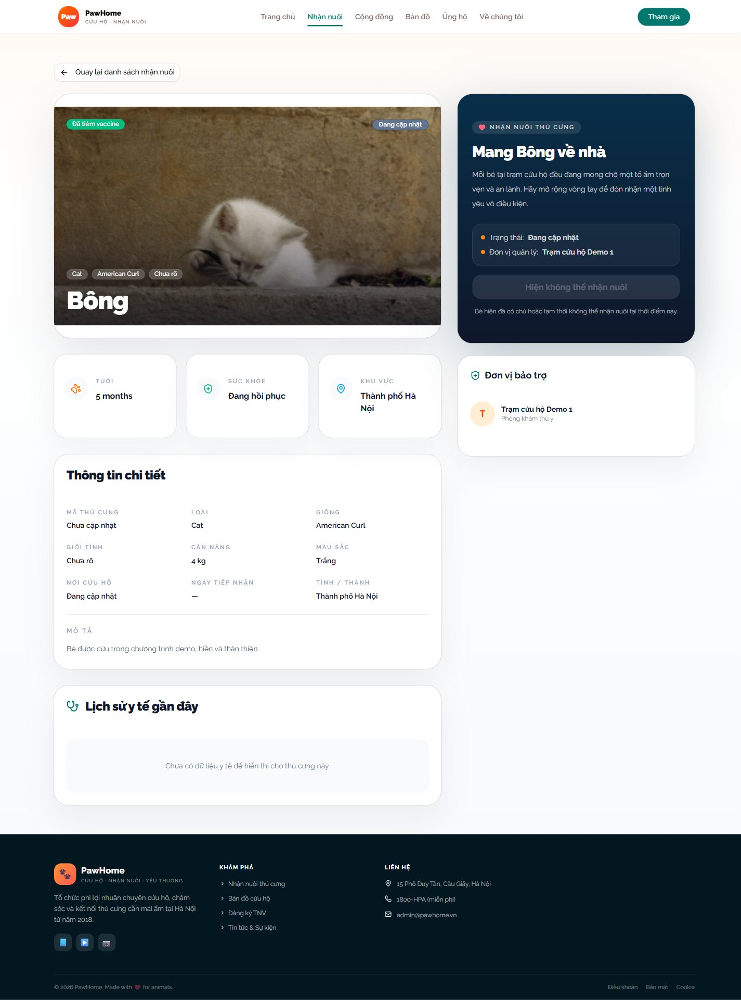
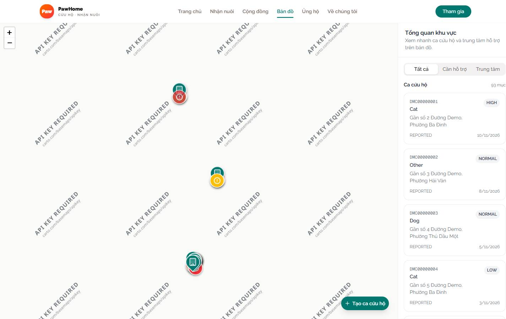
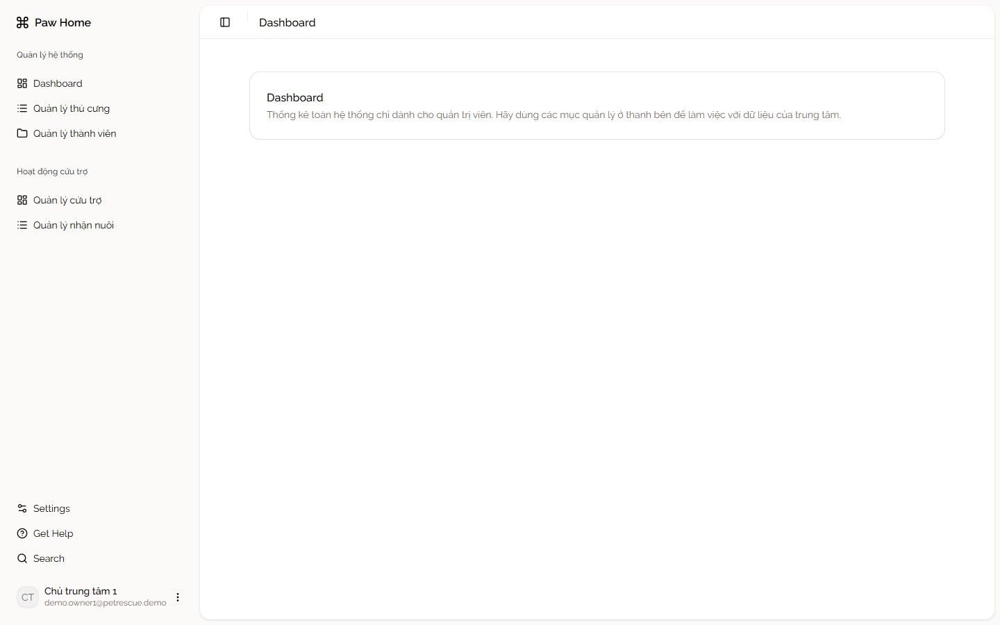
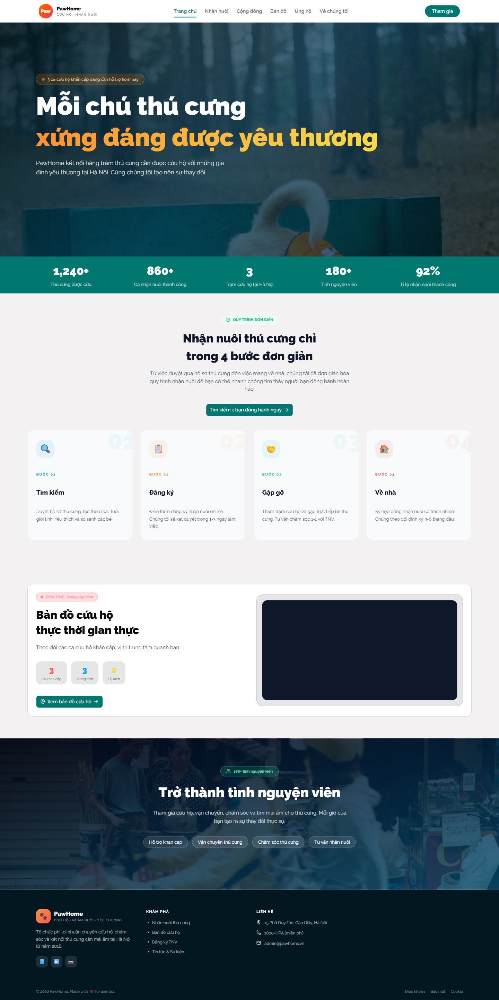
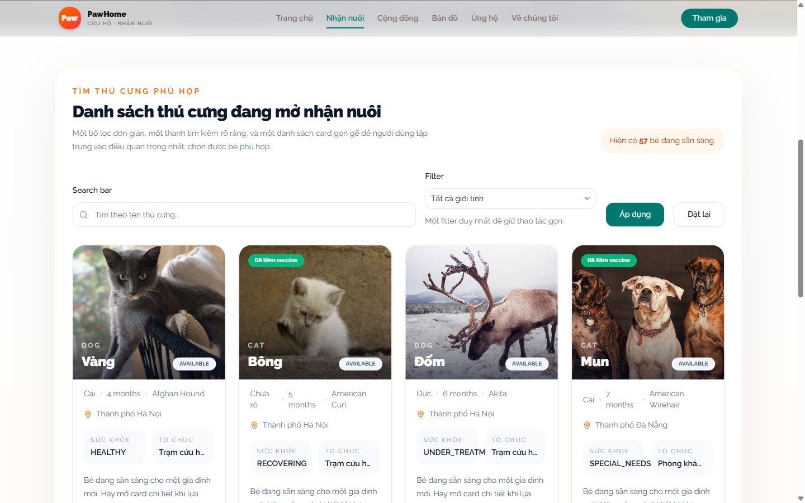
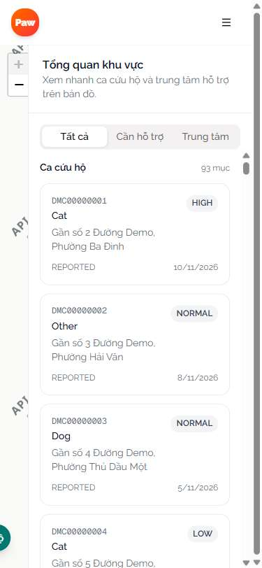

# Kiểm tra FE PawHome dùng API — 2026-11-03

- **FE:** https://paw-home-ui.vercel.app/
- **API:** https://pet-rescue-api-0uhx.onrender.com/api/v1
- **Tài khoản kiểm tra:** admin
- **Đối chiếu với:** code backend trên nhánh `fix/phase-0-authorization` (`b0b951a`)
- **Cập nhật 17/11/2026:** thêm phần [Đánh giá UI/UX](#đánh-giá-uiux--17112026), trải nghiệm bằng các tài khoản demo. Lần chạy này thấy **B1** và **M2** đã được sửa (xem ghi chú ở bảng).

## Cách kiểm tra

Dùng Playwright (Edge, headless) để crawl các trang, ghi lại API call, mở form và bấm submit.

- Mọi request ghi đều bị chặn, trừ đăng nhập. Upload ảnh được giả lập. Không có dữ liệu nào bị thay đổi.
- Vì vậy các lỗi tạo mới được suy ra từ **payload bắt được** và **code backend**, không phải từ phản hồi thật của server.

Mức độ bằng chứng dùng trong tài liệu:

| Nhãn | Ý nghĩa |
|---|---|
| **Runtime** | Quan sát trực tiếp khi chạy (response, giao diện, ảnh chụp) |
| **Bundle** | Đọc từ JS bundle của FE |
| **Suy ra** | Payload bắt được đối chiếu với DTO/route của backend, chưa gửi thật |

## Tổng quan

| ID | Vấn đề | Mức | Sửa ở | Bằng chứng |
|---|---|---|---|---|
| [B1](#b1-nhan-nuoi-hiện-0-thú-cưng) | `/nhan-nuoi` hiện 0 thú cưng — **đã sửa** (17/11: hiện 57 bé) | Chặn | FE | Runtime |
| [B2](#b2-không-tạo-được-thú-cưng) | Không tạo được thú cưng | Chặn | FE | Suy ra |
| [B3](#b3-không-tạo-được-trung-tâm) | Không tạo được trung tâm | Chặn | FE | Suy ra |
| [B4](#b4-ca-cứu-trợ-tạo-từ-admin-mất-ảnh-và-số-điện-thoại) | Ca cứu trợ từ admin mất ảnh và số điện thoại | Chặn | FE | Runtime + Bundle |
| [B5](#b5-form-sửa-trung-tâm-trống-toàn-bộ) | Form sửa trung tâm trống toàn bộ | Chặn | FE | Runtime |
| [B6](#b6-khách-chưa-đăng-nhập-không-thấy-banner) | Khách không thấy banner (401) | Chặn | Backend | Runtime + code |
| [D1](#d1-form-bài-đăng-bắt-gõ-tay-id) | Form bài đăng bắt gõ tay ID | Cao | FE | Runtime + Suy ra |
| [M1](#m1-fe-gửi-size-nhưng-backend-đọc-pagesize) | FE gửi `size`, backend đọc `pageSize` | Cao | FE hoặc backend | Runtime |
| [M2](#m2-dashboard-là-dữ-liệu-mẫu) | Dashboard là dữ liệu mẫu — **đã sửa** (17/11: số liệu thật) | Cao | FE | Runtime |
| [M3](#m3-nút-và-trang-chưa-hoạt-động) | Nút và trang chưa hoạt động | Trung bình | FE | Runtime + Bundle |
| [M4](#m4-endpoint-boundingbox-của-ca-cứu-trợ-không-tồn-tại) | `rescue-cases/map/bounding-box` trả 404 | Trung bình | FE | Runtime |
| [M5](#m5-bảng-trung-tâm-hiện-uuid-thô-và-cột-trống) | Bảng trung tâm hiện UUID thô, cột trống | Thấp | FE/backend | Runtime |
| [M6](#m6-mã-tỉnh-và-mã-phường-trùng-nhau) | `provinceCode` trùng `wardCode` | Trung bình | FE | Runtime |
| [M7](#m7-thiếu-tham-số-bắt-buộc-trả-500) | Thiếu tham số bắt buộc trả 500 | Thấp | Backend | Runtime + code |
| [M8](#m8-endpoint-cũ-còn-trong-cấu-hình-fe) | Endpoint cũ còn trong cấu hình FE | Thấp | FE | Bundle + Runtime |
| [S1](#s1-token-lưu-trong-localstorage) | Token lưu trong `localStorage` | Cần xem xét | FE/backend | Runtime |

---

## Lỗi chặn chức năng

### B1. `/nhan-nuoi` hiện 0 thú cưng

- **Hiện tượng:** trang hiện "Hiện có 0 bé đang sẵn sàng", trong khi `GET /pets` trả `totalElements: 21`.
- **Nguyên nhân:** FE gọi `GET /pets/available?page=0&size=8`. Backend không có route này nên `available` bị hiểu là `{id}`:

  ```json
  {"status":400,"message":"Invalid value 'available' for parameter 'id'"}
  ```
- **Cách sửa:** gọi `GET /pets?status=AVAILABLE&page=0&pageSize=8`.

### B2. Không tạo được thú cưng

- **Payload FE gửi:** `POST /pets/shelter`

  ```json
  {"name":"QA","species":"Chó","breed":"Corgi","age":2,"gender":"UNKNOWN","color":"Vàng","weight":5,
   "description":"qa","vaccinated":false,"neutered":false,"healthStatus":"HEALTHY",
   "rescueDate":"2026-01-01","rescueLocation":"Q1","imageUrls":["..."],"mediaIds":["<uuid>"],
   "shelterId":"<uuid>","rescueCaseId":"case_123"}
  ```
- **Sai lệch với backend:**
  - Backend chỉ có `POST /pets`, không có `/pets/shelter`.
  - `CreatePetRequestDto` yêu cầu `speciesId` (UUID, `@NotNull`) và `breedId`, FE lại gửi `species`/`breed` dạng text.
  - `rescueCaseId` là UUID nhưng form cho gõ tay (`case_123`).
  - DTO không có `rescueDate`, `rescueLocation`, `imageUrls`, nên các giá trị này không được lưu.
- **Cách sửa:** đổi sang `POST /pets`; lấy loài và giống từ `GET /pets/taxonomy` để gửi `speciesId`/`breedId`; đổi `rescueCaseId` thành ô chọn.

### B3. Không tạo được trung tâm

- **Payload FE gửi:** `POST /organizations`

  ```json
  {"name":"QA","type":"SHELTER","email":"qa@example.com","phone":"0901234567",
   "streetAddress":"123 A","wardCode":"","wardName":"Phường 1",
   "provinceCode":"","provinceName":"Hồ Chí Minh","imageUrl":"",
   "latitude":10.780613,"longitude":106.677504}
  ```
- **Nguyên nhân:** `CreateOrganizationRequestDto` đặt `@NotBlank` cho `wardCode` và `provinceCode`, nhưng form chỉ có ô gõ tên, không có mã.
- **Cách sửa:** dùng `GET /locations/p` và `GET /locations/p/{code}` để chọn tỉnh và phường, rồi gửi cả mã lẫn tên.

### B4. Ca cứu trợ tạo từ admin mất ảnh và số điện thoại

- **Hiện tượng:** đã chọn ảnh và nhập `0901234567`, nhưng payload vẫn có `"imageUrls":[],"mediaIds":[],"contactPhone":""`. Ảnh vẫn được upload trước đó nên thành file rác.
- **Nguyên nhân:** trang `/quan-ly-cuu-tro` ghi đè dữ liệu của form ngay lúc submit:

  ```js
  await $.mutateAsync({...e, imageUrls: [], mediaIds: [], contactPhone: ""})
  ```
- **Cách sửa:** bỏ phần ghi đè này và gửi đúng dữ liệu từ form.

### B5. Form sửa trung tâm trống toàn bộ

- **Hiện tượng:** mở "Chỉnh sửa" thì mọi ô đều trống, kể cả tên, dù đã chờ 5 giây.
- **Nguyên nhân:** `GET /organizations/{id}` trả 200 kèm `name`, `wardName`, `latitude`..., nhưng dữ liệu không được điền vào form.
- **Rủi ro:** admin dễ phải nhập lại từ đầu hoặc ghi đè dữ liệu cũ.
- **Cách sửa:** reset form theo dữ liệu chi tiết sau khi tải xong. Backend cũng cần trả đủ trường cần sửa, kể cả `wardCode`/`provinceCode`.

### B6. Khách chưa đăng nhập không thấy banner

- **Hiện tượng:** khi chưa đăng nhập, `GET /banners/active?targetPage=HOME` trả 401. Có token thì trả 200.
- **Nguyên nhân:** `BannerController` ghi chú endpoint này là public, nhưng nó không có trong `PUBLIC_PATHS` (`SecurityConfig.java:38`).
- **Cách sửa:** thêm vào `SecurityConfig`:

  ```java
  .requestMatchers(HttpMethod.GET, "/api/v1/banners/active").permitAll()
  ```

---

## Thiết kế form

### D1. Form bài đăng bắt gõ tay ID

`/quan-ly-bai-dang` → **Thêm bài đăng**. Đây là các ô "lạ" được phản ánh ban đầu. Admin không có màn hình nào để lấy các ID này. Theo DTO, các giá trị mẫu không phải UUID nên sẽ không parse được.

| Ô nhập | FE gửi đi | Backend cần | Nên đổi thành |
|---|---|---|---|
| `Media IDs` | `["media-id-1","media-id-2"]` | `List<UUID>`, tối đa 10 | Upload ảnh qua `/media/upload/temp`, rồi gửi `mediaId` nhận về |
| `Rescue case ID` (có cả ở form thú cưng) | `"case_123"` | `UUID` | Ô chọn ca cứu hộ |
| `Tag codes` | `["rescue","urgent"]` | Mã tag, tối đa 20 | Chọn nhiều từ `GET /tags` |

Form thú cưng, banner và ca cứu trợ đã có sẵn nút upload ảnh, nên có thể dùng lại cho form này. Form sửa bài đăng cũng dùng các ô tương tự (đọc từ bundle; chưa mở được vì hệ thống đang có 0 bài đăng).

---

## Lỗi khác

### M1. FE gửi `size` nhưng backend đọc `pageSize`

Đo trực tiếp trên API:

| Request | Số bản ghi trả về | `size` trong response |
|---|---|---|
| `/users?page=0&size=5` | 20 | 20 |
| `/users?page=0&pageSize=5` | 5 | 5 |
| `/organizations?page=0&size=100&status[]=ACTIVE` | 20 / 26 | 20 |
| `/organizations?page=0&pageSize=100&status=ACTIVE` | 26 / 26 | 100 |

**Hậu quả:**

- Dropdown trung tâm trong form thú cưng thiếu 6/26 trung tâm.
- Ô số dòng hiện 10 nhưng bảng có 20 dòng (ví dụ `/quan-ly-trung-tam`).
- Các danh sách gọi `size=100`, như ca cứu trợ và `/rescue-cases/completions`, sẽ bị cắt khi vượt 20 bản ghi.
- Các trang chi tiết thú cưng cũng gửi `size`, nên `size=3` hay `size=8` đều không có tác dụng.

**Cách sửa:** đổi FE sang `pageSize`, hoặc cho backend nhận thêm `size`.

> `status[]` không bị ảnh hưởng: `/adoptions?status[]=PENDING&status[]=APPROVED` lọc đúng, trả 6/7 bản ghi.

### M2. Dashboard là dữ liệu mẫu

`/dashboard` hiện nội dung template ("Executive summary", "Key Personnel", "Past Performance") và không gọi API nào ngoài `/users/me`.

Backend đã sẵn sàng, cả 5 endpoint đều trả 200 khi có đủ tham số:

- `GET /admin/dashboard/overview?month=&year=`
- `GET /admin/dashboard/adoption-trend?year=`
- `GET /admin/dashboard/rescue-summary?month=&year=`
- `GET /admin/dashboard/top-organizations?month=&year=&limit=`
- `GET /admin/dashboard/pending-tasks?month=&year=`

Đây cũng là trang admin được chuyển tới sau khi đăng nhập.

### M3. Nút và trang chưa hoạt động

| Vị trí | Hiện tượng |
|---|---|
| "Thêm người dùng" (`/quan-ly-nguoi-dung`) | Handler rỗng `handleOpenModal:()=>{}` |
| "Chỉnh sửa" người dùng | Không mở dialog, không chuyển trang, không gọi API |
| `/quan-ly-tin-tuc` (có trên sidebar) | 404 |
| `/web/notifications` (link thông báo ở header) | 404 |

Ngoài ra, `/tin-tuc` và `/ung-ho` không gọi API nội dung nào, nên có thể đang dùng nội dung tĩnh. Cần xác nhận lại với yêu cầu tính năng.

### M4. Endpoint bounding-box của ca cứu trợ không tồn tại

`/ban-do` và `/quan-ly-cuu-tro` gọi lặp lại:

```
GET /rescue-cases/map/bounding-box?minLat=8.5&maxLat=23.5&minLng=102.1&maxLng=109.5&page=0&size=100 → 404
```

Backend chỉ có `/rescue-cases/map/markers` (trả 200) và `GET /rescue-cases` có lọc theo `minLat`, `minLng`, `maxLat`, `maxLng`.

**Cách sửa:** đổi sang một trong hai endpoint này.

### M5. Bảng trung tâm hiện UUID thô và cột trống

Mỗi dòng hiện UUID và các cột `—`, vì API danh sách chỉ trả `organizationId, name, type, status, wardName, provinceName`.

**Cách sửa:** ẩn UUID và bỏ các cột không có dữ liệu, hoặc bổ sung trường cần thiết vào API danh sách.

### M6. Mã tỉnh và mã phường trùng nhau

Khi chọn vị trí trên bản đồ trong form ca cứu trợ, payload có:

```json
{"provinceCode":"72523","provinceName":"Thành phố Hồ Chí Minh","wardCode":"72523","wardName":"Phường Hòa Hưng"}
```

Hai mã giống nhau nên `provinceCode` có vẻ sai. Cần kiểm tra lại đoạn FE xử lý reverse-geocode, và đối chiếu với mã trong `/locations/p`.

### M7. Thiếu tham số bắt buộc trả 500

`GET /admin/dashboard/overview` khi thiếu `month`/`year` trả 500 "An unexpected error occurred", trong khi đây là lỗi của client.

`GlobalExceptionAdvice` không có handler cho `MissingServletRequestParameterException`, nên lỗi rơi vào handler `Exception` chung (`GlobalExceptionAdvice.java:137`).

**Cách sửa:** thêm handler trả 400.

### M8. Endpoint cũ còn trong cấu hình FE

Các đường dẫn sau có trong cấu hình API của FE nhưng không có ở backend. Khi probe, chúng trả 400 hoặc 404. Mình chưa thấy màn hình nào gọi chúng trong lúc crawl.

| Đường dẫn FE | Kết quả |
|---|---|
| `/geo/nearby`, `/geo/me/location` | `/geo/nearby` trả 404; backend đã bỏ `/geo` |
| `/organizations/active`, `/organizations/pending`, `/organizations/inactive` | `active`, `pending` trả 400 |
| `/pets/by-user/{id}`, `/pets/by-organization/{id}` | 404 |
| `/rescue-cases/nearby` | 400 |
| `/admin/organizations/{id}/users/{userId}/pets` | Backend là `/admin/organizations/{id}/pets` (đọc từ code) |
| `/roles/{id}/permissions` | Không có trong controller (đọc từ code) |

---

## Tính năng backend FE chưa dùng

Không tìm thấy trong các bundle đã tải (chỉ gồm các trang đã crawl, nên có thể còn sót):

- Dashboard: `/admin/dashboard/*`
- Chat và bạn bè: `/chats`, `/friends`
- Địa chỉ: `/locations/*` (liên quan B3)
- Taxonomy: `/pets/species`, `/pets/taxonomy` (liên quan B2)
- Phân tích AI: `/posts/{id}/analysis*`, `/admin/ai/*`
- Reclaim: `/adoptions/{id}/reclaim`, `/adoptions/reclaims`
- Media: `/media/register`, `/media/upload/signed`, `/pets/{id}/media/attach`
- Khác: `/users/search`, `/users/me/push-token`

---

## Bảo mật

### S1. Token lưu trong `localStorage`

`accessToken` và `refreshToken` nằm trong `localStorage`, nên sẽ bị lộ nếu site dính XSS. Nên cân nhắc giữ `refreshToken` trong cookie `HttpOnly`.

---

## Chưa kiểm chứng được

- **`petId:""` và `organizationId:""` khi tạo ca cứu trợ:** Jackson có thể đổi `""` thành UUID toàn số 0 cho `petId`. Cần gửi POST thật ở môi trường test để biết chắc. `organizationId` không có trong DTO.
- **Form nhận nuôi:** thú cưng đã mở hiện "Hiện không thể nhận nuôi", nên chưa xem được form và `signatureMediaId`.
- **Sửa bài đăng:** hệ thống đang có 0 bài đăng.
- **Các lỗi B2, B3, D1:** chưa gửi thật lên server. Nên chạy lại ở môi trường test sau khi sửa.

## Đã kiểm tra, không phải lỗi

- Form sửa banner gửi đúng `startDate` và `endDate`.
- `status[]` lọc đúng ở `/adoptions`.
- Đăng nhập chuyển sang `/dashboard` sau khoảng 6 giây (có thể do backend phản hồi chậm).
- Bảng thú cưng không có nút theo dòng nhưng có trang chi tiết `/quan-ly-thu-cung/{id}`.

## Thứ tự sửa đề xuất

1. **Sửa nhanh, tác động lớn:** B1, B6, B4.
2. **Khôi phục luồng tạo và sửa:** B2, B3, B5.
3. **Phân trang:** M1.
4. **Đổi các ô nhập ID:** D1.
5. **Nối dữ liệu thật:** M2, rồi M3 và M4.
6. **Dọn dẹp:** M5–M8, S1.

---

## Đánh giá UI/UX — 17/11/2026

- **Cách làm:** dùng Playwright (Chromium) đi qua web thật ở `https://paw-home-ui.vercel.app` với 4 vai: khách, `demo.user1`, `demo.owner1`, `demo.admin`. Chụp màn hình ở 1440px và 375px, đo độ tương phản, kích thước vùng bấm, thứ tự focus bằng script. Mọi thao tác đều chỉ đọc, trừ **một lần đăng nhập sai** của `demo.user1` để xem thông báo lỗi.
- **Ảnh chụp:** `docs/assets/ux-2026-11-17/`.
- **Giới hạn:** chỉ một người đánh giá. NN/G lưu ý mức độ do một người chấm là chưa đáng tin; nên để 2–3 người chấm lại trước khi chốt ưu tiên. Lúc mở trang đầu tiên, backend Render mất khoảng 15 giây để khởi động. Thời gian chờ đó không tính là lỗi UI.

### Chuẩn dùng để đối chiếu

| Chuẩn | Dùng để xét | Ký hiệu trong bảng |
|---|---|---|
| 10 heuristic của Nielsen (NN/G) | Khả dụng chung | H1–H10 |
| Mức độ nghiêm trọng của Nielsen (0–4) | Xếp ưu tiên | 4 = chặn tác vụ, 3 = lớn, 2 = nhỏ, 1 = thẩm mỹ |
| WCAG 2.2 mức AA | Truy cập | 1.4.3 tương phản chữ ≥ 4.5:1 (chữ lớn ≥ 3:1) · 1.4.11 thành phần giao diện ≥ 3:1 · 2.4.1 bỏ qua khối lặp · 2.4.7 focus thấy được · 2.5.8 vùng bấm ≥ 24×24px · 3.1.1 ngôn ngữ trang · 3.3.1 nhận diện lỗi · 4.1.2 tên/vai trò |
| Laws of UX | Bố cục, lựa chọn | Jakob, Hick, Fitts, Proximity, Similarity, Von Restorff, Doherty (phản hồi < 400ms) |
| Nguyên tắc thị giác | Màu, chữ, khoảng cách | Phân cấp thị giác, tỉ lệ màu 60-30-10, thang cỡ chữ, lưới 8pt, số dạng bảng (tabular figures) cho dữ liệu |
| Material 3 / Apple HIG | Thiết bị cảm ứng | Vùng chạm 48dp / 44pt |

### Kết luận ngắn

1. **Hai luồng chính vẫn đứt ở giao diện.** Không ai nhận nuôi được: nút "Nhận nuôi" luôn bị khoá vì FE so `status === "UNOWNED"`, trong khi API trả `AVAILABLE` (U1). Bản đồ cứu hộ thì phủ kín dòng chữ "API KEY REQUIRED" (U2).
2. **Thiếu một hệ ngôn ngữ chung.** Cùng một dữ liệu lúc thì hiện enum thô (`DOG`, `UNDER_TREATMENT`, `PENDING`), lúc thì đã dịch. Tiếng Anh lẫn tiếng Việt. Còn sót chữ của template shadcn và ghi chú của dev ("Search bar", "Billing", "verified-1@example.com").
3. **Trang public và trang quản trị như hai sản phẩm khác nhau.** Public dùng teal + cam + vàng gradient, ảnh lớn. Quản trị dùng nền be trung tính, không logo, sidebar template ("Settings / Get Help / Search").
4. **Màu nhấn dùng tràn lan và thiếu tương phản.** Có ít nhất 7 màu nhấn trên trang chủ. Nhiều nhãn 9–11px chỉ đạt 1.4–2.9:1, không qua WCAG 1.4.3.
5. **Phần làm tốt:** bảng tin Cộng đồng, form báo ca có bản đồ chọn vị trí, hộp thoại xác nhận khi duyệt/từ chối đơn, skeleton khi tải.

### Tổng quan

| ID | Vấn đề | Nguyên tắc vi phạm | Mức |
|---|---|---|---|
| [U1](#u1-nút-nhận-nuôi-luôn-bị-khoá) | Nút "Nhận nuôi" luôn bị khoá | H1, H4 | 4 |
| [U2](#u2-bản-đồ-không-có-nền) | Bản đồ không có nền (thiếu API key Carto) | H1, H8 | 4 |
| [U3](#u3-chủ-tổ-chức-không-tìm-được-khu-quản-lý) | Chủ tổ chức không tìm được khu quản lý | H6, IA | 3 |
| [U4](#u4-enum-thô-và-nhãn-không-nhất-quán) | Enum thô, cùng dữ liệu mà nhãn khác nhau | H2, H4 | 3 |
| [U5](#u5-chữ-template-và-ghi-chú-dev-lọt-ra-giao-diện) | Chữ template, ghi chú dev, tiếng Anh lọt ra giao diện | H2, H8 | 3 |
| [U6](#u6-phân-cấp-thị-giác-và-bố-cục) | Hero không có CTA, KPI không có phân cấp, breadcrumb sai | Visual hierarchy, H1 | 3 |
| [U7](#u7-màu-sắc) | Quá nhiều màu nhấn, tương phản thấp | 60-30-10, WCAG 1.4.3 | 3 |
| [U8](#u8-chữ) | Chữ quá nhỏ, số kiểu old-style trong dữ liệu | Typography | 2 |
| [U9](#u9-thẻ-và-bảng-dữ-liệu) | Thẻ thú cưng vỡ dòng, bảng tràn ngang, thẻ duyệt đơn giấu thông tin chính | Proximity, H6, H8 | 3 |
| [U10](#u10-form-và-thông-báo-lỗi) | Form báo ca bắt ảnh, nút submit khoá không nói lý do; lỗi đăng nhập bằng tiếng Anh | H5, H9, Postel | 3 |
| [U11](#u11-di-động) | Bản đồ không dùng được trên điện thoại, hero dài hơn một màn hình | Responsive, Fitts | 3 |
| [U12](#u12-truy-cập) | `lang="en"`, nút chỉ có icon không có tên, không có skip link | WCAG 3.1.1, 4.1.2, 2.4.1 | 2 |
| [U13](#u13-nội-dung-làm-giảm-niềm-tin) | Số liệu tĩnh, trang ủng hộ giả, ảnh demo sai loài | H2, độ tin cậy | 3 |
| [U14](#u14-liên-kết-chết) | `/terms`, `/privacy` 404; "Cài đặt" trùng "Xem trang cá nhân" | H3, H4 | 2 |

### U1. Nút "Nhận nuôi" luôn bị khoá



- **Hiện tượng:** thẻ ở `/nhan-nuoi` ghi `AVAILABLE`. Mở chi tiết thì thấy "Trạng thái: Đang cập nhật", nút "Hiện không thể nhận nuôi" bị khoá, kèm câu "Bé hiện đã có chủ". Đăng nhập rồi vẫn vậy. Cùng lỗi này làm KPI "Chờ nhận nuôi" ở `/quan-ly-thu-cung` hiện 0, trong khi có 57 bé.
- **Nguyên nhân:** `app/(public)/nhan-nuoi/[petId]/page.tsx:257` có `const isAdoptable = pet.status === "UNOWNED"`. API (`GET /pets/{id}`) trả `"status": "AVAILABLE"`.
- **Vi phạm:** H1 (trạng thái sai), H4 (danh sách và chi tiết mâu thuẫn nhau). Mức 4 vì chặn luồng chính của người dùng.
- **Cách sửa:** so với `AVAILABLE`. Gom các nhãn trạng thái về một chỗ (xem U4).

### U2. Bản đồ không có nền



- **Hiện tượng:** `/ban-do` và `/quan-ly-cuu-tro` phủ kín ô "API KEY REQUIRED · carto.com/basemaps/apikey". Khung xem trước bản đồ ở trang chủ là một hình chữ nhật tối, trống.
- Form báo ca dùng tile OpenStreetMap thì hiển thị bình thường ([ảnh](assets/ux-2026-11-17/report-form.jpg)), nên hai bản đồ trong cùng sản phẩm đang dùng hai nguồn tile khác nhau.
- **Ngoài ra:** marker chồng lên nhau mà không gom cụm, không có chú giải màu (đỏ/vàng/teal nghĩa là gì?). Danh sách bên phải lấy mã nội bộ `DMC00000001` làm tiêu đề, còn loài và địa chỉ lại xếp sau.
- **Cách sửa:** dùng chung tile OSM (hoặc thêm key Carto). Thêm `leaflet.markercluster` và chú giải. Lấy loài + mức khẩn cấp làm tiêu đề thẻ, đẩy mã ca xuống dòng phụ.

### U3. Chủ tổ chức không tìm được khu quản lý



- Đăng nhập bằng `demo.owner1` xong thì về trang chủ public. Header và menu người dùng chỉ có "Xem trang cá nhân / Cài đặt / Đăng xuất", không có lối vào khu quản lý. Phải tự gõ `/dashboard`.
- Gõ vào rồi thì màn đầu tiên chỉ có một thẻ: "Thống kê toàn hệ thống chỉ dành cho quản trị viên". Đây là trang trống ngay ở điểm vào (vi phạm mẫu Blank Slate).
- **Cách sửa:** thêm mục "Quản lý trung tâm" vào menu người dùng khi `organizationRole` khác null, và sau đăng nhập chuyển thẳng tới đó. Dashboard của tổ chức nên hiện số liệu của chính tổ chức: thú đang nuôi, đơn chờ duyệt, ca đang nhận.

### U4. Enum thô và nhãn không nhất quán

| Dữ liệu | Thẻ `/nhan-nuoi` | Chi tiết | Bảng quản trị |
|---|---|---|---|
| Loài | `DOG`, `CAT` | `Cat` | `Dog` |
| Sức khoẻ | `UNDER_TREATMENT`, `HEALTHY` | "Đang điều trị", "Khỏe mạnh" | "Đang điều trị" |
| Trạng thái | `AVAILABLE` | "Đang cập nhật" | `AVAILABLE`, `FOSTERING` cạnh "Đã nhận nuôi" |
| Tuổi | "4 months" | "5 months" | "1 year 1 month" |
| Mức khẩn cấp / trạng thái ca | `HIGH`, `REPORTED` | — | `PENDING` (dashboard) |

- **Vi phạm:** H2 (không dùng ngôn ngữ của người dùng), H4 (một khái niệm mang nhiều tên).
- **Cách sửa:** tạo một module `lib/labels.ts` chứa toàn bộ nhãn tiếng Việt và màu badge cho từng enum, mọi màn hình đều dùng chung. API đã trả `speciesVi`, `breedVi`, `ageDisplay`, nên dùng luôn.

### U5. Chữ template và ghi chú dev lọt ra giao diện

| Vị trí | Nội dung |
|---|---|
| `/nhan-nuoi` | "ADOPTION CAMPAIGN", nhãn "Search bar", "Filter", "Một filter duy nhất để giữ thao tác gọn", "Một bộ lọc đơn giản… một danh sách card gọn gẽ để người dùng tập trung…" (đây là mô tả thiết kế, không phải nội dung cho người xem) |
| Thẻ thú cưng | "TO CHUC" (mất dấu), "Hãy mở card chi tiết khi lựa nhận nuôi được hoàn thiện" (ghi chú việc chưa làm) |
| Trang chủ | "Hỗ trợ khan cap" (mất dấu) |
| `/ho-so-cua-toi` | Nguyên form "Settings" của shadcn: "Billing", "Appearance", "verified-1@example.com", "You can @mention…", "Update profile" |
| Sidebar quản trị | "Settings", "Get Help", "Search" (không hoạt động) |
| Đăng nhập sai | Toast "Invalid email or password. 4 attempts remaining." (lấy thẳng message của backend) |

**Cách sửa:** rà toàn bộ chuỗi tĩnh, xoá các mục template không dùng. Ánh xạ mã lỗi backend sang câu tiếng Việt ở FE.

### U6. Phân cấp thị giác và bố cục



- **Hero trang chủ không có nút hành động.** Màn đầu tiên chỉ có tiêu đề và đoạn mô tả. Hai việc chính của sản phẩm (báo ca, nhận nuôi) không có trong màn hình đầu. Viên "3 ca cứu hộ khẩn cấp" trông như nhãn tĩnh, không bấm được. Nên đặt 2 CTA: "Báo ca cứu hộ" (chính) và "Tìm bé để nhận nuôi" (phụ).
- **Nút "Tham gia" ở header mơ hồ.** Nó dẫn tới `/dang-nhap` (`Header.tsx:224`), nhưng chữ "Tham gia" gợi tới đăng ký hoặc làm tình nguyện viên. Nên ghi "Đăng nhập".
- **KPI ở dashboard không có phân cấp.** Giá trị ("34") đo được 14px/600, cùng cỡ với nhãn "Trung tâm" (14px/400). Theo phân cấp thị giác, con số phải là thứ nổi nhất (24–32px, đậm), nhãn đứng phụ. Code `components/dashboard/AdminDashboard.tsx` đã đặt `text-2xl` cho `CardTitle`, nhưng bản deploy không nhận class này. Cần kiểm tra style mặc định của `CardTitle` có đè lên không.
- **Breadcrumb luôn ghi "Dashboard"** ở mọi trang quản trị, nên người dùng không biết mình đang ở đâu (H1). Tiêu đề trang cũng khi to khi nhỏ: `Dashboard` 20px thường, `Quản lý thú cưng` 32px đậm.
- **Icon sidebar trùng nhau:** Dashboard, Quản lý bài đăng, Quản lý cứu trợ, Quản lý banner đều dùng icon lưới. Thú cưng và Nhận nuôi cùng dùng icon danh sách. Vi phạm Law of Similarity: icon giống nhau nhưng chức năng khác nhau.
- **Biểu đồ "Đơn nhận nuôi theo tháng"** ([ảnh](assets/ux-2026-11-17/admin-dashboard.jpg)) trống trơn (mọi tháng đều 0), không có câu giải thích nào. Cần một empty state.
- **`/quan-ly-nhan-nuoi`:** tiêu đề ghi "Đơn chờ xét duyệt" nhưng danh sách có cả đơn "Đã duyệt". Tab ghi "Đợi xét duyệt", badge lại ghi "Chờ xét duyệt".

### U7. Màu sắc

**Bảng màu hiện tại (trang chủ):** teal (nút, dải số liệu), cam (logo, chữ nhấn), gradient cam → vàng (tiêu đề hero), xanh trời / cam / xanh lá / đỏ (4 bước), vàng (số "2"), đỏ hồng (nhãn REALTIME). Tức là có ít nhất 7 màu nhấn trong một trang.

- **Vi phạm tỉ lệ 60-30-10 và Von Restorff:** màu nhấn phải hiếm thì mới gây chú ý. Ở đây màu nào cũng nhấn, nên không còn gì nổi bật. Teal vừa là màu nút chính vừa là màu dải trang trí, nên người dùng khó đoán chỗ nào bấm được.
- **Hai hệ màu:** public dùng teal + cam; quản trị dùng nền be ấm, nút teal đậm, không có cam. Trang đăng nhập không có logo, không có màu thương hiệu. Còn nút "Upload image" ở hồ sơ lại màu đen.
- **Đề xuất:** nền trung tính (~60%) · teal là màu thương hiệu, dùng cho bề mặt (~30%) · cam chỉ dùng cho CTA chính (~10%). Đỏ, vàng, xanh lá chỉ dùng cho **trạng thái** (khẩn cấp / chờ / xong), không dùng để trang trí. Gom thành token trong `globals.css`, dùng chung cho cả public và quản trị.

**Tương phản đo được (WCAG 1.4.3, chữ thường cần ≥ 4.5:1):**

| Vị trí | Màu chữ / nền | Cỡ | Tỉ lệ |
|---|---|---|---|
| Số "2 Sự kiện" ở khung bản đồ trang chủ | vàng `rgb(247,219,71)` / trắng | 24px | **1.38** |
| "BƯỚC 01/02/03" ở trang chủ | xanh trời / cam / xanh lá trên trắng | 10px | **2.18–2.73** |
| "BƯỚC 04" | đỏ `rgb(255,88,79)` / trắng | 10px | **3.11** |
| Badge "Đã tiêm vaccine" | trắng / xanh `rgb(13,192,132)` | 10px | **2.36** |
| Nhãn "SỨC KHỎE", "TỔ CHỨC" trên thẻ | xám `rgb(144,161,185)` / trắng | 11px | **2.63** |
| Eyebrow "TÌM THÚ CƯNG PHÙ HỢP" | cam `rgb(255,105,0)` / trắng | 14px | **2.89** |
| Số "01–04" chìm sau thẻ bước | màu bước, nhạt | 72px | trang trí, chấp nhận được |

**Cách sửa:** đẩy màu chữ nhấn lên bậc đậm hơn (ví dụ `orange-700`, `emerald-700`, `sky-700`), hoặc dùng chữ màu đậm trên nền màu nhạt cho badge.

### U8. Chữ

- **Toàn site chỉ dùng Raleway.** Các cỡ đo được: 9, 10, 11, 12, 13, 14, 15, 18, 24, 26, 34, 72px, tức là 12 cỡ không theo một thang nào. Chữ thân bài phổ biến nhất là 13px, nhãn 9–11px. Với tiếng Việt nhiều dấu, chữ dưới 14px khó đọc. Nên dùng một thang cố định (12 / 14 / 16 / 20 / 24 / 32 / 48), với thân bài ≥ 16px trên public và ≥ 14px trên quản trị.
- **Số kiểu old-style:** mặc định, chữ số của Raleway có phần trồi lên và tụt xuống (thấy rõ ở "2026", "1,240+", cột tuổi trong bảng). Kiểu số này đẹp trong văn bản nhưng làm lệch cột và khó so sánh. Với số liệu, bảng và KPI, thêm `font-variant-numeric: lining-nums tabular-nums`.
- **Định dạng số không thống nhất:** trang chủ ghi "1,240+", trang ủng hộ ghi "1.240+". Tiếng Việt dùng dấu chấm, nên dùng `Intl.NumberFormat('vi-VN')`.
- Nhãn chữ hoa giãn rộng ("SỨC KHỎE", "TÌM THÚ CƯNG PHÙ HỢP") dùng quá nhiều. Chữ hoa tiếng Việt có dấu chồng lên nhau, đọc chậm hơn chữ thường.

### U9. Thẻ và bảng dữ liệu



- **Thẻ thú cưng:** hàng "Giới tính • Tuổi • Giống" bị vỡ thành nhiều cột ("Chưa / rõ", "5 / months"). `UNDER_TREATM` bị cắt cứt, không có dấu "…". Tên tổ chức bị cắt còn "Trạm cứu h…". Nên để hàng meta tự xuống dòng như một đoạn văn, và cho badge một độ rộng tối thiểu kèm `truncate`.
- **Bộ lọc** chỉ có một ô giới tính mà vẫn bắt bấm "Áp dụng". Đây là thao tác thừa: chọn xong nên lọc ngay.
- **Bảng `/quan-ly-thu-cung`** tràn ngang ngay ở 1440px. Nút "Thêm thú cưng" bị cắt, phải cuộn ngang mới thấy ([ảnh](assets/ux-2026-11-17/admin-pets.jpg)). Cột "Mã" toàn dấu "-". Nên bỏ cột trống, gộp Loài + Giống, và cố định cột tên.
- **Thẻ duyệt đơn `/quan-ly-nhan-nuoi`** ([ảnh](assets/ux-2026-11-17/admin-adoptions.jpg)): tiêu đề "demo.user10 đăng ký…" bị cắt đúng chỗ tên thú (thông tin quan trọng nhất), trong khi UUID đầy đủ lại tràn ra khỏi thẻ. Hàng chờ duyệt là việc làm đi làm lại (dạng sovereign), nên dùng **bảng** có cột Người nộp / Thú / Ngày / Trạng thái và lọc theo trạng thái, sẽ hợp hơn lưới thẻ.
- **Thẻ "Yêu cầu hoàn thành"** ở `/quan-ly-cuu-tro` chỉ có mã ca bị cắt (`4d13484d...`, font monospace), một câu ghi chú cũng bị cắt, và icon người không kèm tên. Admin không biết mình đang duyệt cái gì (H6). Cần hiện loài, địa chỉ, người cứu và ảnh.

### U10. Form và thông báo lỗi

- **Form báo ca** ([ảnh](assets/ux-2026-11-17/report-form.jpg)):
  - Ảnh là trường bắt buộc. Gặp ca khẩn cấp, người báo có khi không chụp kịp. Nên cho bỏ trống và nhắc bổ sung sau (Postel's Law).
  - Không có nút "Dùng vị trí của tôi". Bản đồ luôn mở ở Q.1 TP.HCM, kể cả khi người dùng ở Hà Nội.
  - "Loài" là ô gõ tự do, trong khi đã có `GET /pets/taxonomy`. Nên dùng ô chọn.
  - Nút "Tạo ca cứu hộ" bị mờ khi thiếu trường nhưng không nói thiếu gì (H9). Nên để nút luôn bấm được, bấm xong thì đánh dấu lỗi ngay tại từng trường.
- **Đăng nhập:**
  - Bấm "Đăng nhập" khi để trống thì hiện "Mật khẩu phải có ít nhất 8 ký tự". Đây là luật của form đăng ký, không áp dụng cho đăng nhập. Chỉ cần báo "Nhập mật khẩu".
  - Lỗi sai mật khẩu hiện bằng tiếng Anh (U5), và chỉ hiện dưới dạng toast, không gắn vào trường nào (WCAG 3.3.1).
- **Nút "Xem trang cá nhân"** trong menu người dùng không chuyển trang khi bấm (lần thử 17/11; gõ thẳng `/ho-so-cua-toi` thì vào được). Cần kiểm tra lại cách lồng `DropdownMenuItem asChild` với `Link`.

### U11. Di động



- `/ban-do` ở 375px: panel danh sách che khoảng 90% bản đồ. Nút "Tạo ca cứu hộ" bị đẩy ra mép trái dưới, gần như mất. Trên điện thoại nên dùng bottom sheet kéo lên được, bản đồ chiếm toàn màn hình, nút báo ca nổi ở góc phải dưới (dễ với ngón cái, theo Fitts).
- `/nhan-nuoi` ở 375px: hero và 3 thẻ giới thiệu chiếm hơn một màn hình, thú cưng đầu tiên chỉ hiện sau khi cuộn khoảng 2 màn. Trên điện thoại nên rút gọn hero còn tiêu đề + ô tìm.
- Không có trang nào bị cuộn ngang ở cấp trang. Bảng quản trị cuộn ngang bên trong khung của nó, chấp nhận được.

### U12. Truy cập

- `<html lang="en">` trên một site tiếng Việt: trình đọc màn hình sẽ đọc tiếng Việt bằng giọng tiếng Anh (vi phạm WCAG 3.1.1, mức A). Sửa trong `app/layout.tsx`: `lang="vi"`.
- Các nút chỉ có icon (duyệt ✓, từ chối ✗, "⋮" ở `/quan-ly-nhan-nuoi`) không có `aria-label` cũng không có tooltip (vi phạm 4.1.2). Người dùng chuột cũng phải đoán. Duyệt và từ chối đặt sát nhau, và chỉ khác nhau ở màu.
- Focus chỉ dùng outline mặc định, mảnh (`outline: auto`), không có skip link (vi phạm 2.4.1). Nên thêm `focus-visible:ring-2` theo màu thương hiệu và một link "Bỏ qua tới nội dung".
- Link ở footer và các nút "Tìm kiếm 1 bạn đồng hành ngay", "Xem bản đồ cứu hộ" chỉ cao 16–19px. Vẫn đạt 2.5.8 nhờ ngoại lệ khoảng cách, nhưng thấp hơn 44–48px mà Material / HIG khuyên cho màn cảm ứng.
- Ảnh đều có `alt`. Form đăng nhập có `label` đúng.

### U13. Nội dung làm giảm niềm tin

- Số liệu "1,240+ thú được cứu, 860+ nhận nuôi, 92%, 3 trạm cứu hộ tại Hà Nội" là số viết cứng, trong khi dữ liệu thật có 8 tổ chức ở TP.HCM, Hà Nội, Đà Nẵng. API dashboard đã có số thật.
- `/ung-ho` là form tĩnh nhưng ghi "An toàn 100% · Thanh toán được mã hóa SSL", "Báo cáo tài chính công khai hàng quý", có danh sách nhà hảo tâm giả và MoMo/VNPay. Nếu còn để trên bản demo công khai thì nên gắn nhãn "Tính năng đang phát triển" và bỏ các cam kết chưa có thật.
- Ảnh demo không khớp loài: thẻ "DOG" là ảnh tuần lộc, thẻ "CAT" là ảnh ba con chó. Đây là lỗi dữ liệu mẫu (`demo_image` trong `seed-postgres.sql`), không phải lỗi UI, nhưng hỏng ngay ấn tượng đầu khi demo. Nên ánh xạ ảnh theo loài.
- Icon lẫn lộn: trang ủng hộ và "Về chúng tôi" dùng emoji (💝 🍚 💉), các trang khác dùng Lucide. Nên dùng một bộ icon.

### U14. Liên kết chết

| Link | Kết quả |
|---|---|
| Footer "Điều khoản" `/terms`, "Bảo mật" `/privacy` | 404 |
| Menu người dùng "Cài đặt" | Trỏ về cùng `/ho-so-cua-toi` với "Xem trang cá nhân" (có `TODO` trong `Header.tsx`) |
| Sidebar "Settings", "Get Help", "Search" | Không có chức năng |

### Đã làm tốt

- **Bảng tin `/cong-dong`:** bố cục một cột dễ quét, nhóm "Ca đang cần giúp" chen giữa feed kèm nút "Đăng bài về ca" (đúng ngữ cảnh). Tab lọc rõ ràng.
- **Form báo ca:** chọn vị trí ngay trên bản đồ, và tách phần bắt buộc với phần "Không bắt buộc" (progressive disclosure).
- **Duyệt/từ chối đơn** có hộp thoại xác nhận (H5).
- Có skeleton khi tải danh sách, form đăng nhập có nút hiện mật khẩu, trang chi tiết có nút "Quay lại danh sách".
- Không trang public nào bị cuộn ngang ở 375px.

### Thứ tự sửa đề xuất (UI/UX)

1. **Mở lại luồng chính:** U1 (một dòng code), U2 (đổi tile), U3 (thêm lối vào cho chủ tổ chức).
2. **Một nguồn nhãn tiếng Việt:** U4, U5, `lang="vi"` (U12). Sửa một lần mà hết lỗi trên mọi màn hình.
3. **Design token:** chốt bảng màu 60-30-10, thang cỡ chữ, tabular figures (U7, U8), dùng chung cho public và quản trị.
4. **Màn quản trị:** breadcrumb, icon, KPI, bảng thay thẻ cho hàng chờ duyệt (U6, U9).
5. **Form và di động:** U10, U11.
6. **Nội dung và dọn dẹp:** U13, U14.

**Nguồn chuẩn:** [WCAG 2.2](https://www.w3.org/TR/WCAG22/) · [Understanding SC 2.5.8 Target Size (Minimum)](https://www.w3.org/WAI/WCAG22/Understanding/target-size-minimum.html) · [NN/G — Severity Ratings for Usability Problems](https://www.nngroup.com/articles/how-to-rate-the-severity-of-usability-problems/) · [NN/G — 10 Usability Heuristics](https://www.nngroup.com/articles/ten-usability-heuristics/) · [Laws of UX](https://lawsofux.com/)
