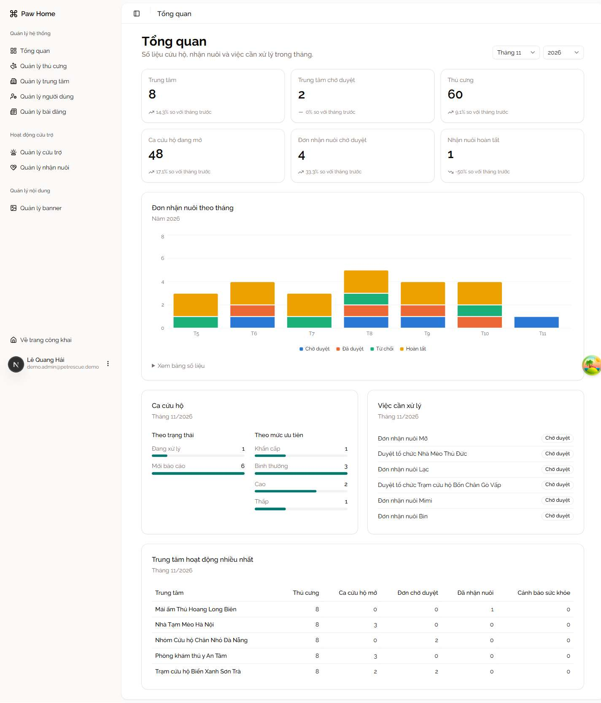
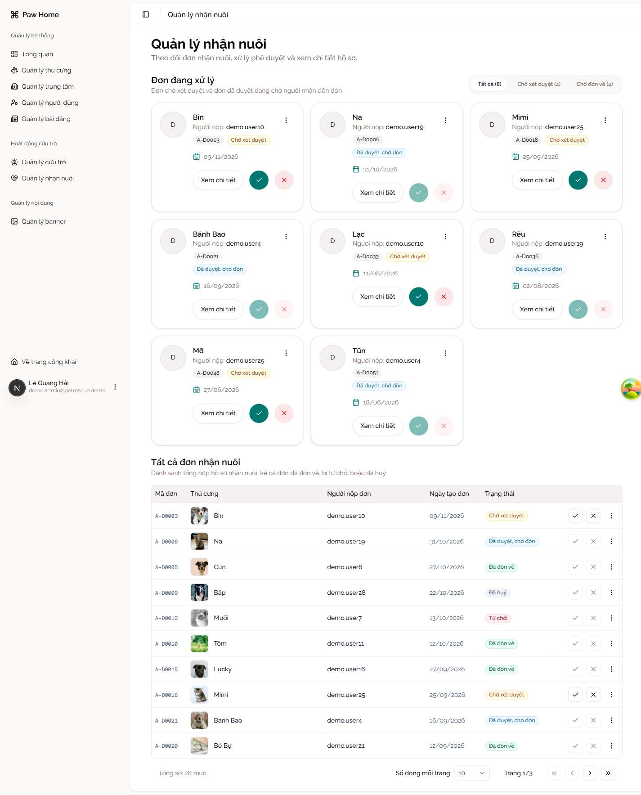
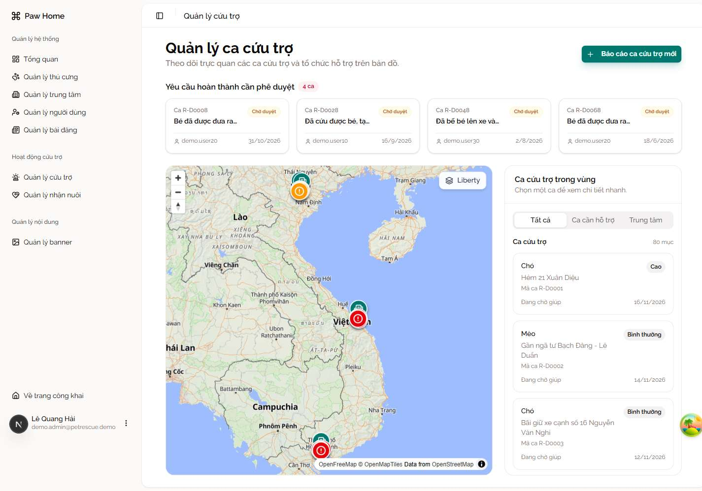
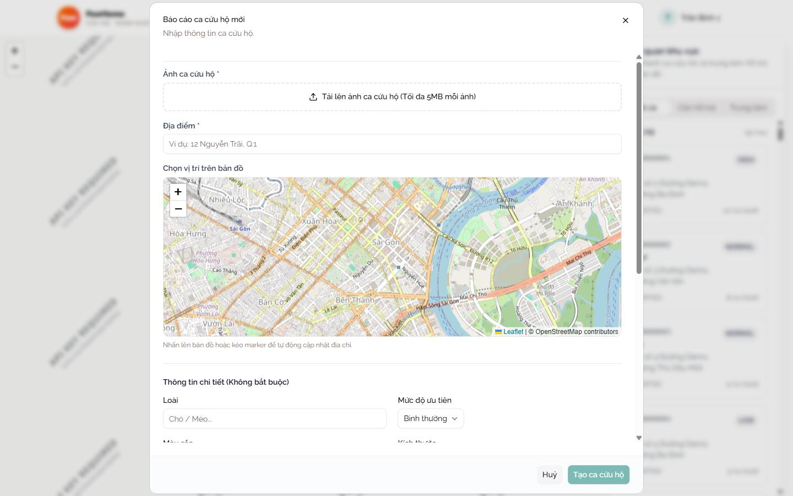

# Đối chiếu hiện trạng FE với BE

Tài liệu này chỉ ghi **những gì còn mở**:

- Lỗi và vấn đề giao diện FE chưa sửa.
- Phân tích UI/UX của khu quản trị: những chỗ cần thiết kế lại, chưa sửa được ngay.
- Những API BE đã làm mà FE chưa dùng.

Mục nào sửa xong thì xoá khỏi tài liệu. Lịch sử các mục đã sửa nằm trong PR của FE (#13, #14, #15) và git log của file này.

| | |
|---|---|
| **Cập nhật** | 18/11/2026 |
| **FE** | `paw-home-ui`: `main` + PR #15 `fix/admin-ux-api-sync` |
| **BE** | `pet-rescue-api`: `master` (`26031c1`, migration tới V35) |
| **Môi trường thử** | FE `localhost:3100` gọi BE `localhost:8081` chạy từ `master`, có dữ liệu demo ở `scripts/demo-data` |
| **Tài khoản** | `demo.admin`, `demo.owner1`, `demo.user1` (mật khẩu ở `scripts/demo-data/README.md`) |

---

## 1. Tóm tắt

- **Khu quản trị đã sạch lỗi hiển thị cơ bản** (PR #15). Kết quả quét 11 trang admin:
  - Không còn UUID và enum thô trên màn hình.
  - Tiêu đề trang cùng một kiểu, phân trang tiếng Việt.
  - KPI thú cưng lấy tổng số từ API.
- **Vấn đề còn lại là về luồng thao tác (CTA):**
  - Màn nhận nuôi hiện mỗi đơn hai lần.
  - Bước tiếp theo của đơn đã duyệt bị giấu trong hộp thoại.
  - "Việc cần xử lý" không dẫn tới đúng việc.
  - Mỗi bảng có một kiểu hành động khác nhau.
  - Khu quản trị có hai kiểu thẻ KPI và màu trạng thái lệch nhau giữa biểu đồ và nhãn.
  - Chi tiết ở mục 2.
- **BE còn thiếu dữ liệu cho UI:** đơn nhận nuôi và danh sách người dùng chỉ có `username`, không có họ tên. Thú cưng chưa lọc được theo sức khoẻ. Chi tiết ở mục 4.
- **Độ phủ API:** BE có **188** endpoint, FE gọi **105**. Phần lớn chỗ thiếu là quy trình nhận và xử lý ca cứu hộ, thông báo, theo dõi sau nhận nuôi và matching (mục 5).

---

## 2. Khu quản trị: phân tích UI/UX

Ảnh chụp ngày 18/11 ở 1440px, tài khoản `demo.admin`, dữ liệu demo.

| Tổng quan | Nhận nuôi | Cứu trợ |
|---|---|---|
|  |  |  |

### A1. Màn nhận nuôi: mỗi đơn hiện hai lần, bước tiếp theo bị giấu

**Mức: cao.** Heuristic: H4 nhất quán, H6 nhận ra thay vì nhớ, H8 tối giản.

- Phần trên là lưới thẻ "Đơn đang xử lý", phần dưới là bảng "Tất cả đơn nhận nuôi". Một đơn chờ duyệt xuất hiện ở cả hai chỗ, và chỗ nào cũng có nút duyệt và nút từ chối. Người duyệt phải tự hỏi hai chỗ này khác nhau ở đâu.
- Thẻ đơn "Đã duyệt, chờ đón" vẫn hiện nút duyệt và nút từ chối, chỉ bị làm mờ. Việc cần làm tiếp theo là xác nhận người nhận đã đón thú. Việc này chỉ có trong hộp thoại "Xem chi tiết".
- Trong bảng, mọi dòng không còn chờ duyệt vẫn hiện hai icon ✓ ✗ bị khoá. Cột thao tác thành nhiễu, khó thấy dòng nào cần xử lý.
- Ảnh đại diện trên thẻ là chữ cái đầu của username ("D" của `demo.userX`) nên thẻ nào cũng giống nhau. Nên dùng ảnh thú: đó là thứ người duyệt nhận ra nhanh nhất.

**Đề xuất (cần review trước khi làm):**

- Bỏ lưới thẻ, chỉ giữ một bảng có tab: Chờ duyệt / Chờ đón / Đã xong / Tất cả.
- Mỗi dòng chỉ hiện **một** nút chính, đúng với trạng thái của đơn:
  - Chờ duyệt: "Duyệt" kèm menu "Từ chối".
  - Chờ đón: "Xác nhận đã đón".
  - Trạng thái khác: không có nút.
- Cột đầu là ảnh và tên thú, cột thứ hai là người nộp (họ tên, cần BE bổ sung ở mục 4).

### A2. Hành động trên bảng mỗi trang một kiểu

**Mức: trung bình.** Heuristic: H4 nhất quán, Jakob's law.

| Trang | Mở chi tiết | Hành động |
|---|---|---|
| Thú cưng | Bấm cả dòng | Không có trên dòng, phải vào trang chi tiết |
| Trung tâm, người dùng, bài đăng | Menu ⋮ → "Xem chi tiết" | Menu ⋮ |
| Nhận nuôi | Nút "Xem chi tiết" hoặc menu ⋮ | Icon ✓ ✗ ngay trên dòng và trên thẻ |
| Cứu trợ | Bấm thẻ ở cột phải | Trong hộp thoại |

**Đề xuất quy tắc chung:**

- Bấm vào dòng thì mở chi tiết, cho mọi bảng.
- Chỉ trang có hàng chờ (nhận nuôi, duyệt trung tâm, duyệt hoàn tất ca) mới có nút chính ngay trên dòng.
- Thao tác phá huỷ (xoá, từ chối) để trong menu ⋮ và luôn hỏi xác nhận.

### A3. "Việc cần xử lý" không dẫn tới đúng việc

**Mức: trung bình.** Heuristic: H7 linh hoạt và hiệu quả.

Ở dashboard, mục "Đơn nhận nuôi Mỡ" hay "Duyệt tổ chức Nhà Mèo Thủ Đức" chỉ dẫn về trang danh sách gốc. Trong code, `AdminDashboard.tsx` cắt `actionUrl` lấy đoạn đầu. Người dùng phải tự tìm lại đơn hoặc tổ chức đó.

**Đề xuất:** mở thẳng đúng đối tượng, ví dụ `/quan-ly-nhan-nuoi?open=<id>`. Trang đích đọc tham số này để mở hộp thoại chi tiết.

### A4. Hai kiểu thẻ KPI, màu trạng thái lệch nhau

**Mức: trung bình.** Heuristic: H4 nhất quán. Liên quan U7, U8 ở mục 3.

- **Thẻ KPI có hai kiểu:**
  - Dashboard: nhãn nhỏ ở trên, số lớn, dòng so sánh tháng trước.
  - `/quan-ly-thu-cung`: icon màu bên trái, nhãn **chữ hoa** 11px. Chữ hoa làm tiếng Việt có dấu khó đọc.
  - Nên dùng một component cho cả hai.
- **Màu trạng thái không thống nhất:**
  - Biểu đồ "Đơn nhận nuôi theo tháng": *Chờ duyệt* màu xanh dương, *Hoàn tất* màu vàng cam.
  - Nhãn trong bảng thì ngược lại: chờ duyệt màu vàng, đã đón màu xanh lá.
  - Nên cho biểu đồ dùng cùng bảng màu với `lib/adoption-display.ts`.
- **Mã đơn trong bảng nhận nuôi dùng font monospace** (`A-D0003`), trong khi mã ca, mã người dùng và mã trung tâm dùng font thường với `tabular-nums`. Nên chọn một kiểu.

### A5. Màn cứu trợ: bản đồ và danh sách không khớp nhau

**Mức: trung bình.** Heuristic: H1 hiện trạng thái hệ thống.

- **Bản đồ và danh sách không khớp:**
  - Bản đồ mở ở mức cả nước và chỉ thấy vài marker.
  - Danh sách bên phải đề "Ca cứu trợ trong vùng" nhưng ghi 80 mục, tức là toàn bộ ca, không theo vùng đang xem.
  - Nên lọc danh sách theo khung bản đồ, hoặc đổi tiêu đề thành "Tất cả ca".
  - Nên thêm gom cụm marker và chú giải màu (đỏ: khẩn cấp, cam: cao, xanh: trung tâm).
- **Thẻ "Yêu cầu hoàn thành cần phê duyệt" thiếu thông tin để duyệt nhanh:**
  - Đã có mã ca và người gửi, nhưng ghi chú bị cắt sau khoảng 20 ký tự và không có ảnh.
  - Người duyệt luôn phải mở hộp thoại so sánh.
  - Nên hiện ảnh xác minh đầu tiên.
- **Admin chưa nhận ca, gán ca hay xem ai đang nhận ca được.** BE đã có các API này (G1, G2, G4 ở mục 5). Đây là thay đổi lớn, cần thiết kế luồng trước.

### A6. Những điểm nhỏ còn lại

- **`/quan-ly-bai-viet`:** route trùng với `/quan-ly-bai-dang`, cùng một trang nhưng breadcrumb ghi "Trang quản lý". Nên chuyển hướng sang `/quan-ly-bai-dang` hoặc xoá route.
- **`/organization/members`:** admin mở trang này thì bị đẩy về trang chủ public, không có thông báo. Nên hiện "Trang này dành cho chủ trung tâm".
- **Thẻ KPI "Cảnh báo sức khỏe" ở `/quan-ly-thu-cung`:** vẫn chỉ đếm trên trang hiện tại, vì `GET /pets` chưa lọc được theo `healthStatus` (mục 4).
- **`/trang-ca-nhan` của admin chỉ để xem:** không sửa được thông tin, không đổi được mật khẩu. Người dùng phải sang trang public `/ho-so-cua-toi`, mà trang đó vẫn là template (U5).

---

## 3. Các lỗi FE còn mở từ các đợt trước

| ID | Vấn đề | Nguyên tắc | Ghi chú |
|---|---|---|---|
| U5 | `/ho-so-cua-toi` vẫn là form template shadcn tiếng Anh: "Settings", "Billing", "verified-1@example.com", "Update profile" | H2, H8 | Cần làm lại trang: thông tin cá nhân, đơn nhận nuôi của tôi, ca tôi báo |
| U7 | Nhãn nhỏ tương phản thấp ở trang chủ: "BƯỚC 01–04" 10px (2.18–3.11:1), số sự kiện màu vàng (1.38:1). Chưa có bảng màu chung | WCAG 1.4.3, 60-30-10 | Đổi sang bậc `-700`; chốt token màu cho cả public và admin |
| U8 | Site dùng 12 cỡ chữ (9–72px), thân bài trang public 13px | Typography | Chốt thang 12 / 14 / 16 / 20 / 24 / 32 / 48, thân bài ≥ 16px |
| U10 | Form báo ca bắt buộc ảnh ("Ảnh ca cứu hộ *"), nút gửi bị khoá mà không nói lý do, ô "Loài" gõ tay | H5, H9 | Bỏ bắt buộc ảnh, thêm "Dùng vị trí của tôi", chọn loài từ `/pets/taxonomy`, báo lỗi tại từng ô |
| U11 | Trên 375px: panel `/ban-do` che khoảng 90% bản đồ; ở `/nhan-nuoi` phải cuộn 2 màn mới thấy thú đầu tiên | Responsive, Fitts | Bottom sheet cho danh sách, nút báo ca nổi ở góc phải dưới; rút gọn hero |
| U12 | Thiếu link "Bỏ qua tới nội dung", focus ring chưa theo màu thương hiệu | WCAG 2.4.1, 2.4.7 | |
| U13 | Số liệu viết cứng: "1.240+ thú được cứu", "3 trạm tại Hà Nội" (`ung-ho/data.json`, `ve-chung-toi/data.json`). `/ung-ho` ghi "mã hoá SSL", MoMo/VNPay nhưng form không gửi đi đâu | Độ tin cậy | Lấy số từ API dashboard; gắn nhãn "đang phát triển" cho `/ung-ho` |
| U14 | Footer trỏ tới `/terms` và `/privacy`, cả hai đều 404 | H3 | Thêm hai trang hoặc bỏ link |
| M6 | `provinceCode` có thể trùng `wardCode` khi chọn vị trí trên bản đồ (thấy ngày 03/11) | | **Cần kiểm chứng**: gửi một ca trên môi trường test rồi đối chiếu với `/locations/p` |
| S1 | `accessToken` và `refreshToken` nằm trong `localStorage` (`lib/http.ts`) | Bảo mật | **Cần quyết định**: chuyển `refreshToken` sang cookie `HttpOnly; Secure; SameSite=Strict` |

Ảnh trước khi sửa của các mục U10, U11 (chụp 17/11):

| Form báo ca | Bản đồ trên điện thoại |
|---|---|
|  |  |

---

## 4. BE còn thiếu cho UI

| # | Thiếu | Ảnh hưởng | Đề xuất |
|---|---|---|---|
| BE1 | `AdoptionSummaryResponseDto` chỉ có `applicantUsername` | Bảng và thẻ duyệt đơn hiện `demo.user10` thay vì họ tên | Thêm `applicantFullName` (và ảnh đại diện nếu có) |
| BE2 | `UserSummaryResponseDto` không có `fullName` | Bảng người dùng và các ô chọn người chỉ hiện username | Thêm `fullName` |
| BE3 | `GET /pets` bỏ qua `healthStatus` (gửi `healthStatus=UNDER_TREATMENT` vẫn trả 60/60) | KPI "Cảnh báo sức khỏe" chỉ đếm được trên trang hiện tại | Thêm bộ lọc `healthStatus`, hoặc một API đếm thú theo trạng thái và sức khoẻ |
| BE4 | `POST /pets`, `PUT /pets/{id}`, `PATCH /pets/{id}/status` giờ chỉ trả `id` | FE chưa lỗi vì chỉ làm mới cache, nhưng `services/pet/pet.ts` vẫn khai báo kiểu trả về là `Pet` | Sửa kiểu ở FE thành `{ id: string }` để không ai dùng nhầm sau này |

---

## 5. BE đã có, FE chưa dùng

Danh sách sinh bằng script: so 188 endpoint trong `presentation/controller` của `master` với các đường dẫn trong mã FE (PR #15). Các nhóm quan trọng đã grep lại bằng tay.

| # | Tính năng | Endpoint BE chưa dùng | Ai cần | Ưu tiên |
|---|---|---|---|---|
| G1 | **Nhận ca và xử lý ca cứu hộ** | `POST /rescue-cases/{id}/claim`, `.../claim/extend`, `.../claim/release`, `GET .../claims`, `POST .../intake`, `POST .../keep-pet`, `GET .../triage`, `POST/GET .../updates` | Người dùng, tổ chức | **Cao**: lõi Giai đoạn 1. FE mới đọc được "ca tôi đang nhận" |
| G2 | **Duyệt báo cáo hoàn tất ca** | `GET /rescue-cases/completions/review-queue`, `GET .../completions/{id}`, `POST .../completions/{id}/confirm`, `.../dispute`, `.../reject` | Người báo ca, admin | **Cao** |
| G3 | **Thông báo** | `GET /notifications`, `GET /notifications/unread-count`, `PATCH /notifications/{id}/read`, `PATCH /notifications/read-all` | Mọi người | **Cao**: BE đã gửi thông báo cứu hộ nhưng web chưa có chuông |
| G4 | **Hàng chờ ca của tổ chức** | `GET /organizations/me/rescue-queue` | Tổ chức | **Cao** |
| G5 | **Thú đi lạc / nhặt được** (PR #22) | `POST /pets/{id}/report-lost`, `GET /rescue-cases/{id}/matches`, `POST .../matches/{suggestionId}/confirm`, `.../reject`, `POST .../convert-to-rescue` | Người dùng | Trung bình. FE đã có kiểu `caseType` và nhãn "Thú đi lạc / Nhặt được thú", chưa có màn báo lạc và ghép cặp |
| G6 | **Báo cáo sai và kiểm duyệt ca** | `POST /rescue-cases/{id}/flags`, `DELETE .../flags/me`, `GET /admin/rescue-cases/flagged`, `GET /admin/rescue-cases/metrics`, `GET /admin/matching/metrics` | Người dùng, admin | Trung bình |
| G7 | **Theo dõi sau nhận nuôi** | 11 endpoint của `FollowupController`: `/followups/respond`, `/adoptions/{id}/followups`, `.../support-request`, `.../return-request`, `.../outcome`, `/organizations/me/followup-alerts`, `/admin/followups/metrics` | Người nhận nuôi, tổ chức | Trung bình (Giai đoạn 2) |
| G8 | **Matching** | `GET/PUT /users/me/adopter-profile`, `.../suggestion`, `GET/PUT /pets/{petId}/traits`, `GET /pets/{petId}/match` | Người dùng, tổ chức | Trung bình (Giai đoạn 2) |
| G9 | **Thu hồi sau nhận nuôi** và đơn theo tổ chức | `POST /adoptions/{id}/reclaim`, `GET /adoptions/reclaims`, `GET /adoptions/organization/{orgId}` | Tổ chức | Trung bình |
| G10 | **Gợi ý ca trùng, sơ cứu, thú của tôi, tìm người** | `GET /rescue-cases/possible-duplicates`, `GET /rescue-cases/first-aid`, `GET /users/me/pets`, `GET /users/search`, `PATCH /pets/{id}/visibility` | Người dùng | Trung bình |
| G11 | **AI phân tích bài đăng** | 8 endpoint `/posts/{id}/analysis*`, `/admin/ai/post-analysis/*` | Admin | Thấp |
| G12 | **Chat, bạn bè, media nâng cao, push, quản trị phụ** | 6 `/chats/*`, 5 `/friends/*`, `POST /media/upload/signed`, `/media/register`, `/pets/{petId}/media/attach`, `/users/me/push-token`, `GET/DELETE /roles/{id}`, `DELETE /tags/{id}` | Tuỳ phạm vi | Thấp |

Không cần làm: `/pets/species` và `/pets/species/{id}/breeds` (FE đã dùng `/pets/taxonomy`), `/dev/create-account` (chỉ có ở profile `dev`).

---

## 6. Thứ tự nên làm

1. **Review và merge FE PR #15.**
2. **A1: gộp màn nhận nuôi thành một bảng**, mỗi dòng một nút theo trạng thái. Làm cùng BE1 để hiện họ tên người nộp.
3. **G1 + G2 + G4 + A5: luồng xử lý ca.**
   - Trên chi tiết ca: nút "Nhận ca" và "Trả ca".
   - Trang "Ca tôi đang nhận" có nút gửi báo cáo hoàn tất.
   - Trang hàng chờ cho tổ chức.
   - Hàng chờ duyệt hoàn tất cho admin, có ảnh xác minh.
4. **G3: chuông thông báo** ở header. Gọi `unread-count` mỗi 60 giây, khi mở danh sách thì gọi `/notifications`.
5. **A2 + A3 + A4: quy tắc chung cho khu quản trị.**
   - Bấm dòng mở chi tiết.
   - Một component KPI dùng chung.
   - Biểu đồ dùng bảng màu trạng thái chung.
   - "Việc cần xử lý" mở đúng đối tượng.
6. **U7, U8: design token** (màu 60-30-10, thang cỡ chữ) cho cả public và admin.
7. **U5, U13, U14: nội dung.** Làm lại `/ho-so-cua-toi`, lấy số liệu thật, thêm trang điều khoản và bảo mật.
8. **U10, U11:** form báo ca và giao diện di động.

---

## Phụ lục

### A. Cách kiểm tra

- **Script quét trang admin:** `scripts/ux-audit/`. Script đăng nhập, mở từng trang, chụp ảnh và đếm:
  - UUID và chữ IN_HOA kiểu enum trong vùng `main`;
  - cỡ chữ H1/H2;
  - vị trí nút.

  Lần 18/11: 11 trang admin, 0 UUID, 0 enum thô.
- **Độ phủ API:** script so endpoint trong controller BE với chuỗi đường dẫn trong mã FE. Các nhóm có ưu tiên cao đã kiểm lại bằng grep.
- **Thao tác thật:** không gửi đơn, không duyệt hay tạo ca trong lần kiểm tra này. M6 vẫn cần một lần gửi thật.
- Chỉ một người đánh giá. NN/G khuyên mức độ nghiêm trọng nên do 2–3 người chấm độc lập.

### B. Chuẩn đối chiếu

| Chuẩn | Dùng cho |
|---|---|
| 10 heuristic của Nielsen (H1–H10) | Khả dụng chung |
| WCAG 2.2 AA: 1.4.3, 2.4.1, 2.4.7, 3.3.1 | Truy cập |
| Laws of UX: Jakob, Hick, Fitts, Proximity | Bố cục, hành động |
| Phân cấp thị giác, 60-30-10, thang cỡ chữ, tabular figures | Màu và chữ |

Nguồn: [WCAG 2.2](https://www.w3.org/TR/WCAG22/) · [NN/G 10 Heuristics](https://www.nngroup.com/articles/ten-usability-heuristics/) · [NN/G Severity Ratings](https://www.nngroup.com/articles/how-to-rate-the-severity-of-usability-problems/) · [Laws of UX](https://lawsofux.com/)
