# Đối chiếu hiện trạng FE với BE

Tài liệu này theo dõi hai việc:

- Những lỗi đã tìm thấy trên FE (API, giao diện, trải nghiệm) và trạng thái hiện tại của từng lỗi.
- Những tính năng BE đã làm xong mà FE chưa có màn hình.

Lần cập nhật nào cũng sửa thẳng vào bảng, không viết thêm phần mới ở cuối.

| | |
|---|---|
| **Cập nhật** | 17/11/2026 |
| **FE** | `paw-home-ui`: `origin/main` (`98846aa`) và nhánh sửa `fix/ux-quick-wins` (3 commit, chưa merge) |
| **BE** | `pet-rescue-api`: `origin/master` (`4c0a0fc`) |
| **Môi trường thử** | FE chạy `localhost:3100` gọi API staging `pet-rescue-api-0uhx.onrender.com` (có dữ liệu demo). Bản deploy `paw-home-ui.vercel.app` dùng làm mốc "trước khi sửa". |
| **Tài khoản** | `demo.admin`, `demo.owner1`, `demo.user1` (mật khẩu ở `scripts/demo-data/README.md`) |

**Cách đọc cột Trạng thái:**

| Trạng thái | Nghĩa |
|---|---|
| **Đã sửa** | Đã có trên `main` của FE (hoặc `master` của BE) |
| **Sửa ở nhánh** | Đã sửa trên `fix/ux-quick-wins`, đã chạy thử ở local, chờ merge |
| **Một phần** | Đã sửa một phần, phần còn lại ghi ở mục 5 |
| **Chưa sửa** | Còn nguyên |
| **Cần kiểm chứng** | Chưa chắc là lỗi; cần thao tác ghi thật hoặc người khác xem lại |

---

## 1. Tóm tắt

- **Lỗi API cũ (đợt 03/11):** 16 mục. 14 mục đã sửa, M6 cần kiểm chứng, S1 chưa sửa vì cần quyết định thiết kế.
- **Lỗi UI/UX (đợt 17/11):** 15 mục.
  - 4 mục đã sửa ở nhánh và chạy thử ở local: U1 nút nhận nuôi, U2 bản đồ, U3 lối vào cho chủ tổ chức, U15 khung bản đồ trang chủ.
  - 8 mục sửa một phần.
  - 3 mục chưa sửa: U8 chữ, U11 di động, U13 nội dung giả.
- **Độ phủ API:** BE có **161** endpoint, FE gọi **105**.
  - 56 endpoint còn lại gom thành 12 nhóm tính năng (mục 3).
  - Nặng nhất là **quy trình nhận ca cứu hộ** và **thông báo**. Đây là phần lõi của Giai đoạn 1 mà người dùng web chưa làm được.

---

## 2. Bảng trạng thái

### 2.1 Lỗi chặn luồng

| ID | Vấn đề | Trạng thái | Ghi chú |
|---|---|---|---|
| B1 | `/nhan-nuoi` hiện 0 thú | **Đã sửa** | Hiện 57 bé |
| B2 | Không tạo được thú (sai route, gửi tên loài thay vì `speciesId`) | **Đã sửa** | FE gọi `POST /pets` và lấy loài từ `/pets/taxonomy` (đọc code) |
| B3 | Không tạo được trung tâm (thiếu mã tỉnh/phường) | **Đã sửa** | Form có ô chọn tỉnh, phường từ `/locations` (đọc code) |
| B4 | Ca cứu trợ từ admin mất ảnh và số điện thoại | **Đã sửa** | Không còn đoạn ghi đè `imageUrls: []` (đọc code) |
| B5 | Form sửa trung tâm trống | **Đã sửa** | Form `reset()` theo dữ liệu chi tiết |
| B6 | Khách không thấy banner (401) | **Đã sửa** | BE thêm `/banners/active` vào `permitAll` |
| U1 | Nút "Nhận nuôi" luôn bị khoá: FE so `UNOWNED`, BE trả `AVAILABLE` | **Sửa ở nhánh** | FE dùng đúng enum BE ở mọi nơi. Khách bấm thì được mời đăng nhập |
| U2 | Bản đồ không có nền ("API KEY REQUIRED" của Carto) | **Một phần** | Đã đổi sang tile OSM. Còn thiếu gom cụm marker và chú giải màu |
| U3 | Chủ tổ chức đăng nhập xong về trang chủ, không có lối vào quản lý | **Sửa ở nhánh** | Chuyển thẳng tới `/dashboard`, thêm mục "Quản lý trung tâm" ở menu, màn đầu có lối tắt |

### 2.2 Dữ liệu và API

| ID | Vấn đề | Trạng thái | Ghi chú |
|---|---|---|---|
| M1 | FE gửi `size`, BE đọc `pageSize` | **Đã sửa** | |
| M2 | Dashboard admin là dữ liệu mẫu | **Đã sửa** | Gọi 5 API `/admin/dashboard/*` |
| M3 | Nút "Thêm/Sửa người dùng" rỗng, link `/quan-ly-tin-tuc` và `/web/notifications` 404 | **Đã sửa** | |
| M4 | Gọi `rescue-cases/map/bounding-box` (404) | **Đã sửa** | Dùng `/rescue-cases/map/markers` |
| M5 | Bảng trung tâm hiện UUID và cột trống | **Đã sửa** | |
| M6 | `provinceCode` trùng `wardCode` khi chọn vị trí trên bản đồ | **Cần kiểm chứng** | Phải gửi một ca thật trên môi trường test mới biết |
| M7 | Thiếu tham số bắt buộc trả 500 | **Đã sửa** | BE có handler `MissingServletRequestParameterException` |
| M8 | Endpoint cũ còn trong cấu hình FE | **Đã sửa** | |
| D1 | Form bài đăng bắt gõ tay Media ID, Case ID, Tag | **Đã sửa** | |
| U16 | KPI ở `/quan-ly-thu-cung` chỉ đếm thú trên trang hiện tại (hiện 7 thay vì 57) | **Chưa sửa** | Xem mục 5 |
| S1 | Token lưu trong `localStorage` | **Chưa sửa** | Cần quyết định có chuyển `refreshToken` sang cookie `HttpOnly` không |

### 2.3 Giao diện và trải nghiệm

| ID | Vấn đề | Nguyên tắc | Trạng thái |
|---|---|---|---|
| U4 | Enum thô (`DOG`, `UNDER_TREATMENT`, `HIGH`, `PENDING`), nhãn khác nhau giữa các màn | H2, H4 | **Một phần**: thú cưng, bản đồ, việc cần xử lý đã dịch |
| U5 | Chữ template, ghi chú dev, tiếng Anh lọt ra giao diện | H2, H8 | **Một phần**: `/nhan-nuoi`, thẻ thú, lỗi đăng nhập đã sửa. Còn `/ho-so-cua-toi` |
| U6 | Hero không có CTA, KPI không phân cấp, breadcrumb sai, icon sidebar trùng | Phân cấp thị giác, H1 | **Một phần**: còn tiêu đề "Đơn chờ xét duyệt" lệch nội dung |
| U7 | Quá nhiều màu nhấn, nhãn nhỏ tương phản 1.4–2.9:1 | 60-30-10, WCAG 1.4.3 | **Một phần**: badge thẻ thú đã đạt 4.5:1. Còn trang chủ và bảng màu chung |
| U8 | 12 cỡ chữ, thân bài 13px, số kiểu old-style | Typography | **Chưa sửa** |
| U9 | Thẻ thú vỡ dòng, bảng tràn ngang, thẻ duyệt đơn giấu tên thú | Proximity, H6 | **Một phần**: thẻ thú, bảng thú đã sửa. Còn thẻ duyệt đơn, thẻ hoàn tất ca |
| U10 | Form báo ca bắt ảnh, nút khoá không nói lý do; lỗi đăng nhập | H5, H9 | **Một phần**: đăng nhập đã sửa. Còn form báo ca |
| U11 | Bản đồ không dùng được trên điện thoại, hero dài hơn một màn | Responsive, Fitts | **Chưa sửa** |
| U12 | `lang="en"`, nút icon không có tên, không có skip link | WCAG 3.1.1, 4.1.2, 2.4.1 | **Một phần**: `lang="vi"` và `aria-label` đã có. Còn skip link, focus ring |
| U13 | Số liệu viết cứng, trang ủng hộ giả, ảnh demo sai loài | Độ tin cậy | **Chưa sửa** |
| U14 | `/terms`, `/privacy` 404; "Cài đặt" trùng trang hồ sơ; sidebar template | H3, H4 | **Một phần**: chỉ còn `/terms`, `/privacy` |
| U15 | Khung bản đồ trang chủ là ô đen (iframe `google.com/maps` bị chặn) | H1 | **Sửa ở nhánh**: nhúng OSM |

Ảnh sau khi sửa, chụp ở local:

| Thẻ thú cưng | Bảng quản trị thú cưng | Màn đầu của chủ tổ chức |
|---|---|---|
| 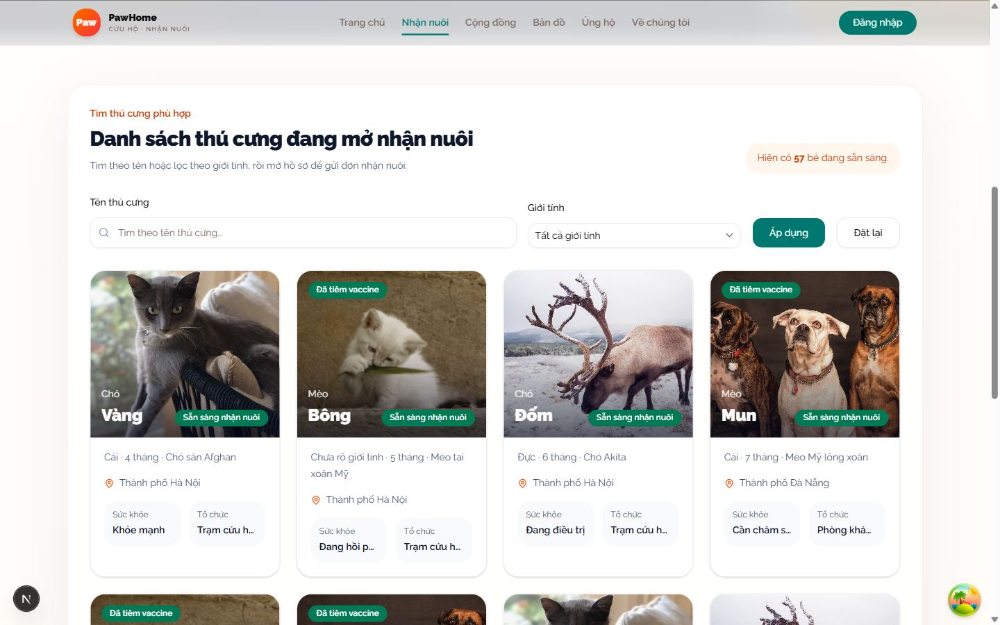 | 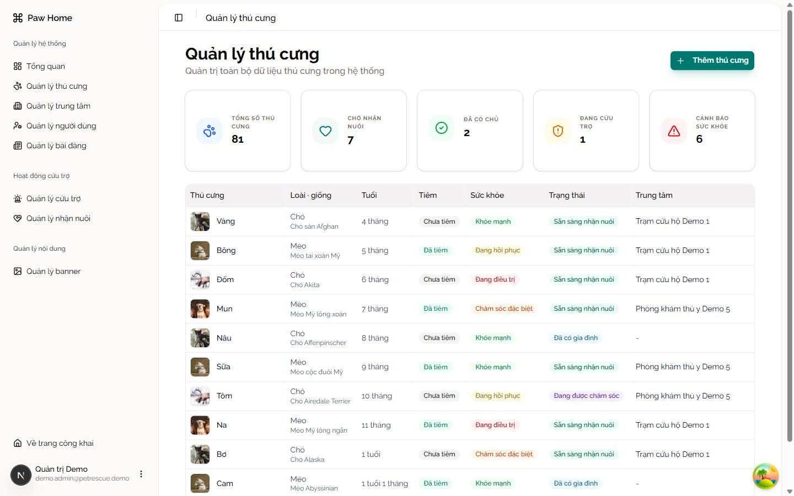 | 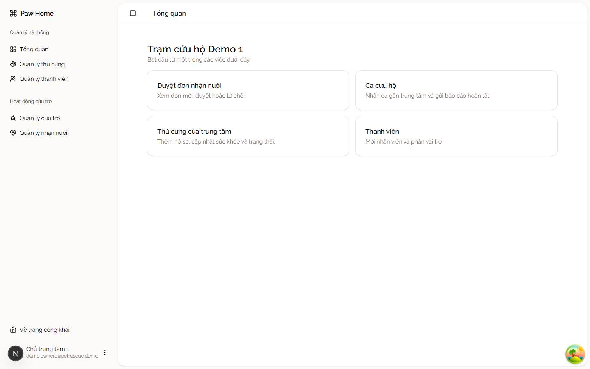 |

---

## 3. BE đã có, FE chưa có

Danh sách sinh tự động bằng cách so 161 endpoint trong `presentation/controller` của `origin/master` với các đường dẫn xuất hiện trong mã FE. Các nhóm quan trọng đã được grep lại bằng tay.

| # | Tính năng | Endpoint BE chưa dùng | Ai cần | Ưu tiên |
|---|---|---|---|---|
| G1 | **Nhận ca và xử lý ca cứu hộ**: nhận ca, gia hạn, trả ca, xem người nhận, tiếp nhận về trạm, giữ thú sau cứu | `POST /rescue-cases/{id}/claim`, `.../claim/extend`, `.../claim/release`, `GET .../claims`, `POST .../intake`, `POST .../keep-pet` | Người dùng, tổ chức | **Cao**: lõi Giai đoạn 1. FE mới đọc được "ca tôi đang nhận" (`/users/me/rescue-claims`) |
| G2 | **Duyệt báo cáo hoàn tất ca**: hàng chờ duyệt, người báo xác nhận, khiếu nại, từ chối | `GET /rescue-cases/completions/review-queue`, `GET .../completions/{id}`, `POST .../completions/{id}/confirm`, `.../dispute`, `.../reject` | Người báo ca, admin | **Cao** |
| G3 | **Thông báo**: danh sách, số chưa đọc, đánh dấu đã đọc | `GET /notifications`, `GET /notifications/unread-count`, `PATCH /notifications/{id}/read`, `PATCH /notifications/read-all` | Mọi người | **Cao**: BE đã bắn 7 loại thông báo cứu hộ nhưng web không có chuông |
| G4 | **Hàng chờ ca của tổ chức** | `GET /organizations/me/rescue-queue` | Tổ chức | **Cao**: tổ chức chưa thấy ca gần mình để nhận |
| G5 | **Gợi ý ca trùng khi báo** | `GET /rescue-cases/possible-duplicates` | Người báo ca | Trung bình |
| G6 | **Thú của tôi** và **tìm người dùng** | `GET /users/me/pets`, `GET /users/search` | Người dùng | Trung bình |
| G7 | **Matching**: hồ sơ người nhận nuôi, đặc điểm thú, điểm phù hợp | `GET/PUT /users/me/adopter-profile`, `GET/PUT /pets/{petId}/traits`, `GET /pets/{petId}/match` | Người dùng, tổ chức | Trung bình (Giai đoạn 2) |
| G8 | **Thu hồi sau nhận nuôi** và đơn theo tổ chức | `POST /adoptions/{id}/reclaim`, `GET /adoptions/reclaims`, `GET /adoptions/organization/{orgId}` | Tổ chức | Trung bình |
| G9 | **AI phân tích bài đăng** | `GET /posts/{id}/analysis`, `PATCH .../confirm`, `POST .../reject`, `POST .../retry`, `GET/PUT/DELETE /admin/ai/post-analysis/model`, `GET /admin/ai/post-analysis/metrics` | Admin | Trung bình |
| G10 | **Chat và bạn bè** | 6 endpoint `/chats/conversations/*`, 5 endpoint `/friends/*` | Người dùng | Thấp, tuỳ phạm vi đồ án |
| G11 | **Media nâng cao** và push | `POST /media/upload/signed`, `POST /media/register`, `POST /pets/{petId}/media/attach`, `POST /users/me/push-token` | Hệ thống | Thấp: FE đang dùng `upload/temp`; push dành cho app di động |
| G12 | **Quản trị phụ** | `GET/DELETE /roles/{id}`, `DELETE /tags/{id}` | Admin | Thấp |

Không cần làm:

- `/pets/species`, `/pets/species/{id}/breeds`: FE đã dùng `/pets/taxonomy` thay thế.
- `/dev/create-account`: chỉ có ở profile `dev`.

**BE đang làm, chưa merge vào `master`** (nhánh `feature/phase-2b-my-pets`):
- `FollowupController`: theo dõi sau nhận nuôi.
- Endpoint mới trong Matching, Pet, RescueCase, User.

Khi các nhánh này merge thì chạy lại bảng này.

---

## 4. Việc nên làm tiếp

1. **Merge `fix/ux-quick-wins` (FE)** và deploy. Nhánh này mở lại luồng nhận nuôi (U1) và lối vào cho chủ tổ chức (U3).
2. **G1 + G2 + G4: màn hình nhận và xử lý ca.** Gợi ý tối thiểu:
   - Trên chi tiết ca, thêm nút "Nhận ca" và "Trả ca".
   - Thêm trang "Ca tôi đang nhận" có nút gửi báo cáo hoàn tất.
   - Thêm trang hàng chờ cho tổ chức.
   - Thêm trang duyệt hoàn tất cho admin.
3. **G3: chuông thông báo** ở header. Gọi `unread-count` mỗi 60 giây, mở danh sách thì gọi `/notifications`.
4. **U16:** lấy số KPI từ `totalElements` của `GET /pets?status=AVAILABLE&pageSize=1`, thay vì đếm trên trang.
5. **Design token (U7, U8):**
   - Chốt bảng màu 60-30-10 và thang cỡ chữ.
   - Thêm `tabular-nums` cho số liệu.
   - Áp dụng cho cả trang public và trang quản trị.
6. **Di động (U11):** trên `/ban-do`, đổi panel thành bottom sheet; rút gọn hero ở `/nhan-nuoi`.
7. **Nội dung (U13, U14, U5):**
   - Gắn nhãn "đang phát triển" cho `/ung-ho`.
   - Lấy số ở trang chủ từ API dashboard.
   - Làm lại `/ho-so-cua-toi`, thêm trang điều khoản và bảo mật.
   - Ánh xạ ảnh demo theo loài trong `seed-postgres.sql`.

---

## 5. Chi tiết các mục còn mở

### U2. Bản đồ: gom cụm và chú giải

Nền bản đồ đã hiện lại. Còn ba việc:
- Marker chồng nhau khi zoom xa. Thêm `leaflet.markercluster`.
- Không có chú giải cho marker đỏ, vàng, teal.
- Ở trang `/quan-ly-cuu-tro` (`page.tsx:270`), thẻ ca vẫn lấy mã ca làm tiêu đề và hiện enum thô. Trang `/ban-do` đã đổi sang loài + địa chỉ + nhãn tiếng Việt, nên chép lại cách làm đó.

### U4, U5. Nhãn và chữ còn sót

- `/ho-so-cua-toi` vẫn là form template shadcn tiếng Anh: "Settings", "Billing", "verified-1@example.com", "Update profile".
- Thẻ "Yêu cầu hoàn thành" ở `/quan-ly-cuu-tro` hiện mã ca bị cắt và icon người không kèm tên.
- Nhãn trạng thái thú, sức khoẻ, giới tính, tuổi đã gom về `lib/pet-display.ts`. Nhãn tổ chức gom về `lib/organization-display.ts`. Nhãn ca cứu hộ đã có sẵn ở `lib/rescue-case-display.ts`. Màn hình mới nên dùng các module này, không tự viết `switch` riêng.

### U6, U9. Hàng chờ duyệt đơn nhận nuôi

- Tiêu đề ghi "Đơn chờ xét duyệt" nhưng danh sách có cả đơn đã duyệt. Tab ghi "Đợi xét duyệt", còn badge ghi "Chờ xét duyệt".
- Tiêu đề thẻ bị cắt đúng chỗ tên thú, trong khi UUID đầy đủ tràn ra khỏi thẻ.
- Hàng chờ là việc làm lặp lại, nên đổi sang bảng: Người nộp / Thú / Ngày / Trạng thái, có lọc theo trạng thái.

### U7, U8. Màu và chữ

| Vị trí | Tỉ lệ đo được | Cách sửa |
|---|---|---|
| "BƯỚC 01–04" ở trang chủ (10px) | 2.18–3.11 | Đổi sang bậc `-700` |
| Số "2 Sự kiện" màu vàng | 1.38 | Dùng chữ đậm trên nền vàng nhạt |
| Badge "Đã tiêm vaccine" | 2.36 → **5.5** | Đã sửa ở nhánh (`emerald-700`) |
| Nhãn "SỨC KHỎE / TỔ CHỨC" (11px) | 2.63 → **7.24** | Đã sửa ở nhánh (`slate-600` trên `slate-50`, 14px, bỏ chữ hoa) |

Về chữ: site dùng 12 cỡ (9–72px). Nên chốt thang 12 / 14 / 16 / 20 / 24 / 32 / 48. Thân bài trang public ≥ 16px. Tiếng Việt dùng `Intl.NumberFormat('vi-VN')` để ghi "1.240" thay vì "1,240".

### U10. Form báo ca

- Bỏ bắt buộc ảnh. Ca khẩn cấp có khi không chụp kịp.
- Thêm nút "Dùng vị trí của tôi".
- Đổi ô "Loài" sang ô chọn từ `/pets/taxonomy`.
- Để nút "Tạo ca cứu hộ" luôn bấm được. Bấm xong thì đánh dấu lỗi ngay tại từng trường thiếu.

### U11. Di động (375px)

- `/ban-do`: panel danh sách che khoảng 90% bản đồ, nút "Tạo ca cứu hộ" bị đẩy ra mép. Nên dùng bottom sheet, nút báo ca ở góc phải dưới.
- `/nhan-nuoi`: thú cưng đầu tiên chỉ hiện sau khoảng 2 màn cuộn.

### U12. Truy cập còn thiếu

- Thêm link "Bỏ qua tới nội dung" (WCAG 2.4.1).
- Thêm `focus-visible:ring-2` theo màu thương hiệu (2.4.7).

### U13. Nội dung làm giảm niềm tin

- Trang chủ và "Về chúng tôi" ghi cứng "1,240+ thú được cứu, 3 trạm tại Hà Nội", trong khi dữ liệu có 8 tổ chức ở 3 thành phố.
- `/ung-ho` ghi "An toàn 100% · mã hoá SSL", có danh sách nhà hảo tâm giả và MoMo/VNPay, nhưng form không gửi đi đâu.
- Ảnh demo không khớp loài (tuần lộc gắn nhãn chó). Lỗi nằm ở bảng `demo_image` trong `scripts/demo-data/seed-postgres.sql`, không phải ở UI.

### U16. KPI trang thú cưng

`getKpis()` ở `app/(admin)/quan-ly-thu-cung/page.tsx` đếm trên mảng của trang hiện tại, tối đa 20 dòng. Nên lấy `totalElements` theo từng trạng thái, hoặc thêm API đếm theo trạng thái ở BE.

### M6. Mã tỉnh trùng mã phường

Lần chụp ngày 03/11 thấy payload có `provinceCode = wardCode = "72523"`. Code hiện tại lấy `provinceCode` từ kết quả reverse-geocode (`RescueCaseCreate.tsx:288`). Cần gửi một ca trên môi trường test rồi đối chiếu với `/locations/p`.

### S1. Token trong `localStorage`

`lib/http.ts` lưu `accessToken` và `refreshToken` trong `localStorage`. Nếu site dính XSS thì lộ cả hai. Phương án: BE đặt `refreshToken` trong cookie `HttpOnly; Secure; SameSite=Strict`, FE chỉ giữ `accessToken` trong bộ nhớ.

---

## Phụ lục

### A. Cách kiểm tra

- **Lỗi API (03/11):** crawl bằng Playwright, chặn mọi request ghi trừ đăng nhập, đối chiếu payload với DTO của BE. Lần 17/11 kiểm lại bằng đọc code `origin/main`.
- **UI/UX (17/11):**
  - Đi qua web với 4 vai (khách, user, chủ tổ chức, admin) ở 1440px và 375px.
  - Đo tương phản, vùng bấm, thứ tự focus bằng script.
  - Chỉ một người đánh giá. NN/G lưu ý mức độ do một người chấm chưa đáng tin, nên để 2–3 người chấm lại.
- **Kiểm thử local sau khi sửa:** chạy `pnpm dev` trên `fix/ux-quick-wins` gọi API staging.
  - Khách: `/nhan-nuoi` hiện 57 bé, nhãn tiếng Việt. Nút "Nhận nuôi ngay" bật, bấm thì hiện yêu cầu đăng nhập.
  - Khách: `/ban-do` tải tile OSM. Trang chủ có 2 CTA.
  - Chủ tổ chức: đăng nhập xong chuyển tới `/dashboard`, thấy lối tắt; menu có "Quản lý trung tâm".
  - Admin: KPI 30px, breadcrumb đúng tên trang, bảng thú không tràn ngang, nút duyệt/từ chối có `aria-label`.
  - `tsc --noEmit` sạch. ESLint không có lỗi mới. 5 lỗi cũ có sẵn trên `main` ở `quan-ly-thu-cung/page.tsx` và `nhan-nuoi/page.tsx`.
  - Không gửi đơn, không tạo ca, không duyệt đơn nào.

### B. Chuẩn đối chiếu

| Chuẩn | Dùng cho |
|---|---|
| 10 heuristic của Nielsen (H1–H10), thang mức 0–4 | Khả dụng chung |
| WCAG 2.2 AA: 1.4.3, 1.4.11, 2.4.1, 2.4.7, 2.5.8 (24×24px), 3.1.1, 3.3.1, 4.1.2 | Truy cập |
| Laws of UX: Jakob, Hick, Fitts, Proximity, Similarity, Von Restorff | Bố cục |
| Phân cấp thị giác, 60-30-10, thang cỡ chữ, tabular figures | Màu và chữ |
| Material 3 (48dp) / Apple HIG (44pt) | Vùng chạm |

Nguồn: [WCAG 2.2](https://www.w3.org/TR/WCAG22/) · [SC 2.5.8](https://www.w3.org/WAI/WCAG22/Understanding/target-size-minimum.html) · [NN/G Severity Ratings](https://www.nngroup.com/articles/how-to-rate-the-severity-of-usability-problems/) · [NN/G 10 Heuristics](https://www.nngroup.com/articles/ten-usability-heuristics/) · [Laws of UX](https://lawsofux.com/)

### C. Ảnh trước khi sửa (bản deploy, 17/11)

| | |
|---|---|
| Trang chủ: hero không CTA, khung bản đồ đen | 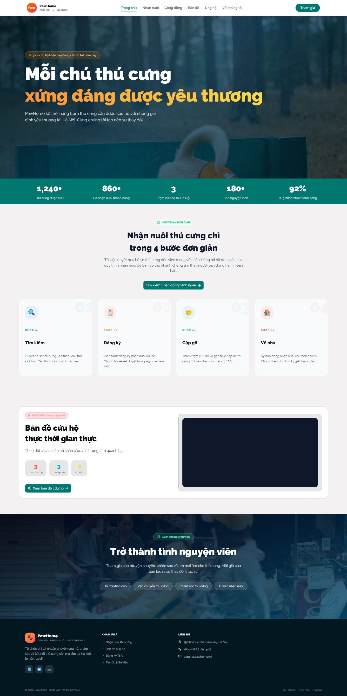 |
| Thẻ thú: enum thô, vỡ dòng | 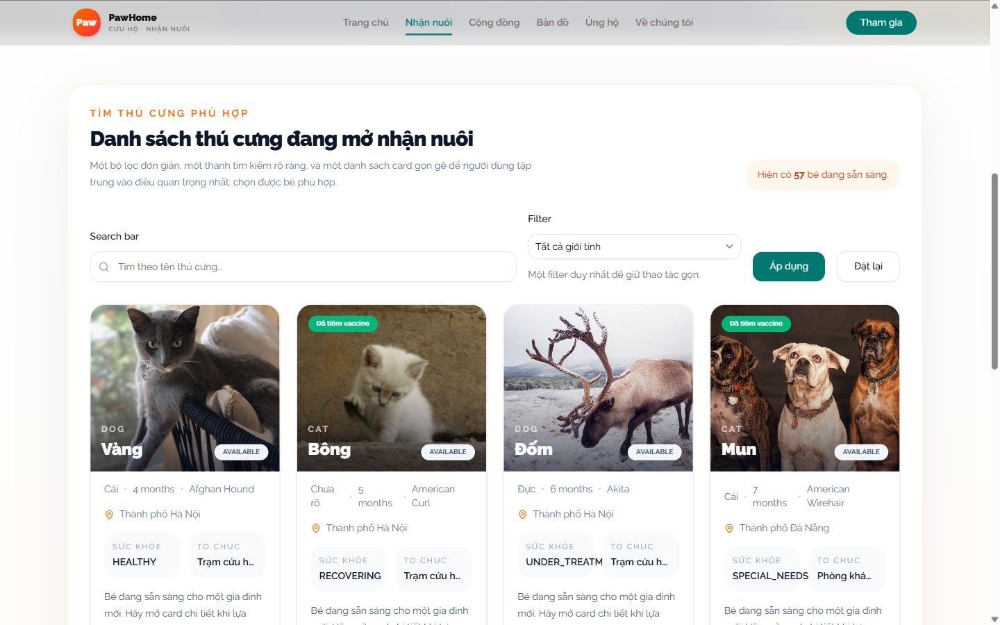 |
| Chi tiết thú: nút nhận nuôi bị khoá | 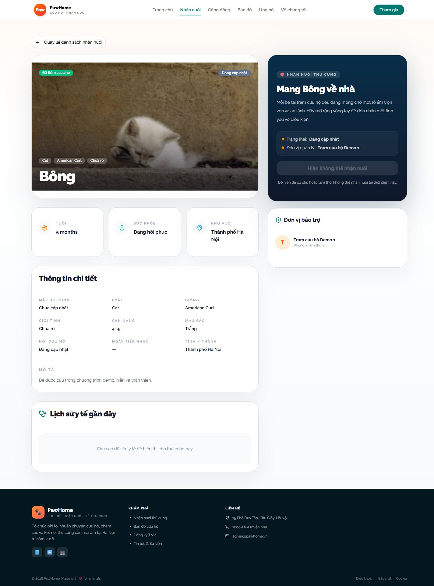 |
| Bản đồ: thiếu API key Carto | 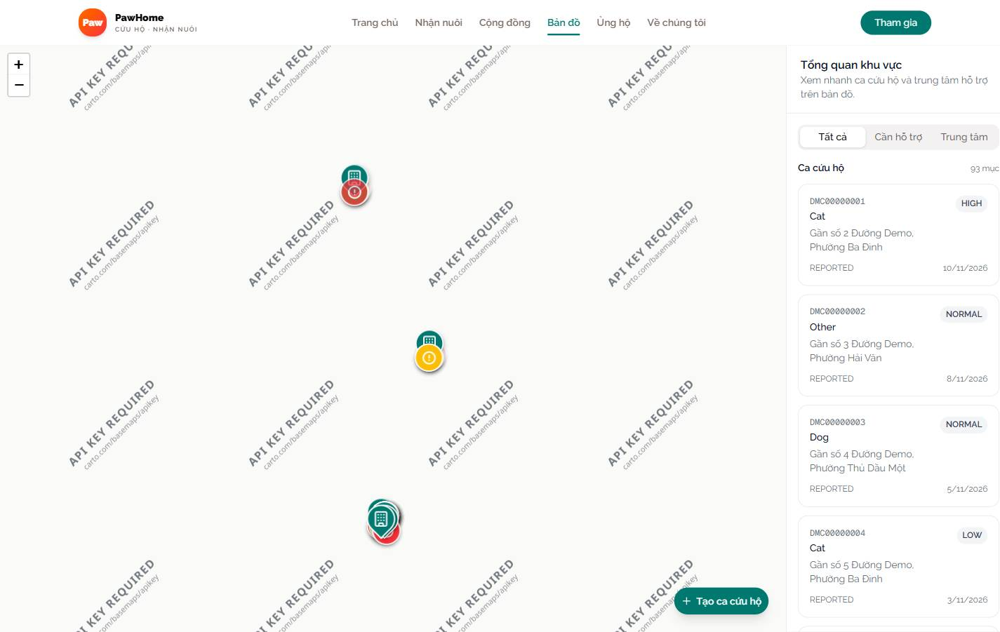 |
| Bản đồ trên điện thoại | 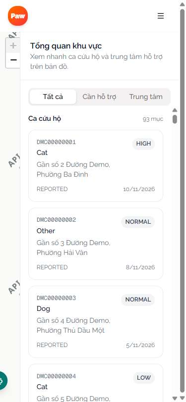 |
| Form báo ca |  |
| Dashboard admin | 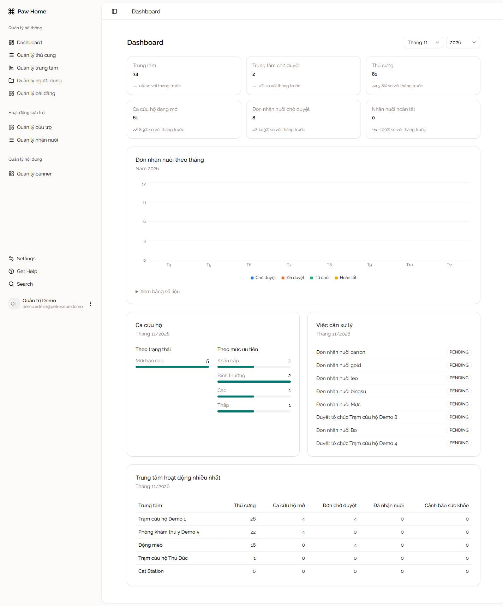 |
| Bảng thú cưng tràn ngang | 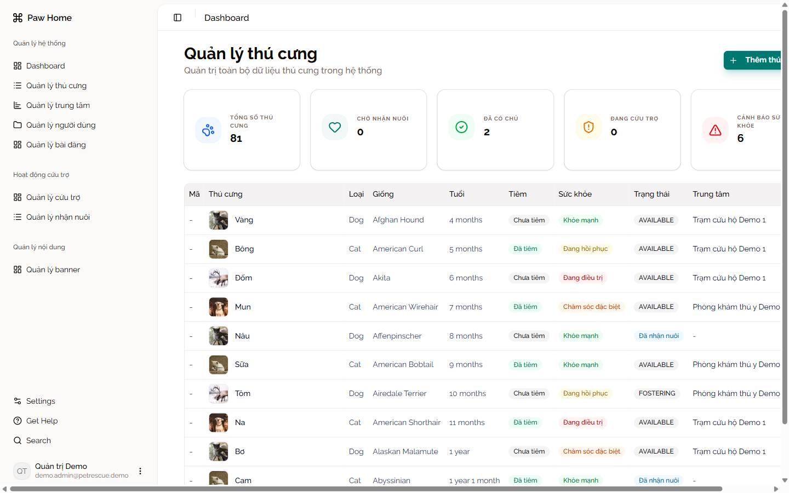 |
| Thẻ duyệt đơn | 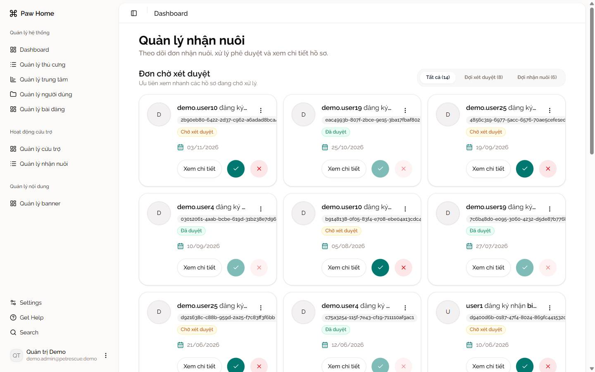 |
| Dashboard chủ tổ chức trống | 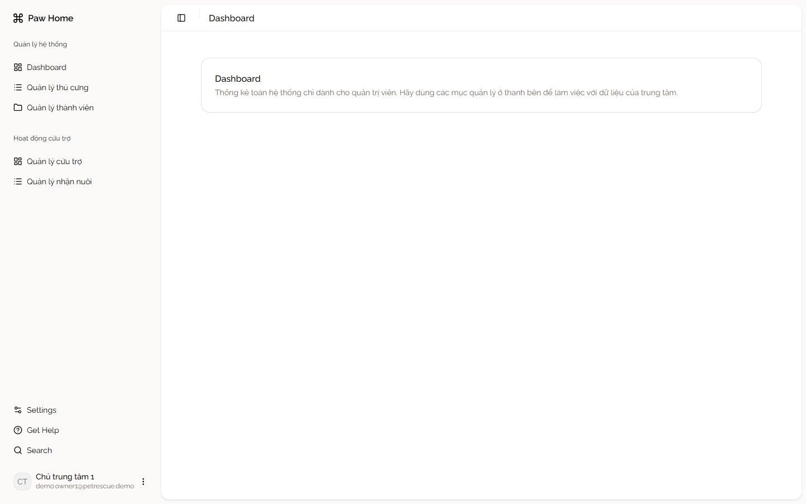 |
